# AquaSentinel

**An offline-first AI pond guardian for shrimp farmers.** AquaSentinel watches pond water around the clock with real sensors, predicts disease outbreaks and night-time oxygen crashes before they happen, switches aerators automatically, and talks to farmers in six Indian languages, with or without internet.

> Built for the Agritech & Aquaculture hackathon track: **Smart Shrimp Disease & Water-Quality Monitoring**.
> "AquaSentinel" is a working name.

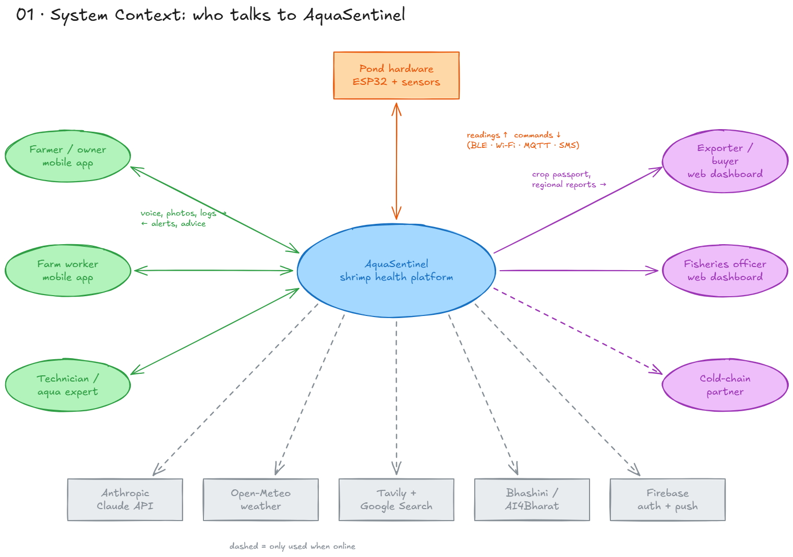

---

## Contents

1. [The problem](#1-the-problem)
2. [What AquaSentinel does](#2-what-aquasentinel-does)
3. [System design](#3-system-design)
4. [How the main flows work](#4-how-the-main-flows-work)
5. [AI and machine learning](#5-ai-and-machine-learning)
6. [The AI assistant (Claude)](#6-the-ai-assistant-claude)
7. [Offline-first and downloadable packs](#7-offline-first-and-downloadable-packs)
8. [Languages](#8-languages)
9. [Hardware](#9-hardware)
10. [Tech stack](#10-tech-stack)
11. [Datasets](#11-datasets)
12. [Security and the crop passport](#12-security-and-the-crop-passport)
13. [Deployment](#13-deployment)
14. [Repository layout](#14-repository-layout)
15. [Getting started](#15-getting-started)
16. [Roadmap](#16-roadmap)
17. [References and research credits](#17-references-and-research-credits)
18. [License](#18-license)

---

## 1. The problem

Disease is the largest money leak in Indian shrimp farming, and it is usually noticed only after shrimp start dying.

| Fact | Number | Source |
|---|---|---|
| Chance that a farm suffers an infectious disease (survey of 909 farms, 23 coastal districts) | 49% | [R1] |
| Shrimp lost to disease in India each year | about 0.21 million tonnes, worth about US$1.02 billion | [R1] |
| Loss caused by EHP alone | about US$571 million a year | [R2] |
| Andhra Pradesh share of India's vannamei output | 77.8% | [R3] |
| Feed share of production cost on intensive farms | roughly 60 to 67% | industry estimates |
| 2025 export rejections linked to antibiotic residues (EU, US, Japan) | 43% of rejections, a government figure | [R4] |

Three problems sit underneath these numbers:

1. **Night oxygen crashes.** Dissolved oxygen (DO) falls after sunset and is lowest before dawn. Farms pay a night watchman or run aerators all night, which wastes electricity [R5].
2. **Disease triggers are environmental and visible early.** White spot outbreaks follow sudden temperature drops, heavy rain and salinity falls [R6][R7]. The warning signs exist days before mortality.
3. **Diagnosis is slow and some diseases are invisible.** PCR needs a lab. EHP shows up mainly as slow growth and uneven sizes, not as visible lesions [R8][R9].

Published research already reaches 95%+ accuracy on shrimp disease photos [R10][R11]. What is missing is a system that **fuses sensors, weather, growth and photos**, warns **before** symptoms, works **offline**, and tells the farmer **what to do** in their own language.

---

## 2. What AquaSentinel does

| # | Feature | Works offline? |
|---|---|---|
| **Pond monitoring** | | |
| 1 | Live DO, pH, temperature, salinity and turbidity per pond | Yes |
| 2 | Automatic aerator control with safety rules on the ESP32 | Yes |
| 3 | Night oxygen crash forecast (DO at 4 am, predicted at 9 pm) | Yes |
| 4 | Power-cut alert: the ESP32 detects mains failure and alerts the farmer to start the generator | Yes, by SMS |
| 5 | Aerator health: a current sensor detects a stopped or failing motor | Yes |
| 6 | Sensor self-check for fouled or drifting probes, plus calibration reminders | Yes |
| 7 | Toxic ammonia calculated from pH, temperature and salinity, so no ammonia probe is needed | Yes |
| **Disease and health** | | |
| 8 | Disease outbreak risk 48 hours ahead | Partly (uses cached weather) |
| 9 | Photo diagnosis with a heatmap (white spot, black gill, healthy, other) | Yes |
| 10 | Plain-language explanation of the photo result from a vision-language model | Yes, small model; better online |
| 11 | EHP slow-growth detector | Yes |
| 12 | Water colour check from a photo (plankton bloom type) | Yes |
| 13 | LAMP / PCR test logging and lab finder | Partly |
| 14 | Treatment guidance without antibiotics, with escalation to an expert | Partly |
| **Feed and growth** | | |
| 15 | Feed tray photo check (0, 25, 50 or 100% leftover) | Yes |
| 16 | Feed advisor that cuts the ration when DO is low or risk is high | Yes |
| 17 | Shrimp count and size from a photo, giving biomass and FCR automatically | Yes |
| 18 | Growth curve compared with the expected curve | Yes |
| 19 | Optional hydrophone for detecting feeding activity by sound | Yes |
| **Farm business** | | |
| 20 | Expense, inventory and profit tracker | Yes |
| 21 | Market price tracker and price forecast | Online |
| 22 | Harvest planner: best harvest date from growth, price and risk | Partly |
| 23 | Crop calendar and task reminders | Yes |
| 24 | Pond preparation and seed (PL) quality checklists | Yes |
| 25 | PDF reports for bank loans and insurance | Yes |
| 26 | Government schemes and insurance information from the knowledge base | Partly |
| **AI assistant** | | |
| 27 | Voice chatbot in six languages | Yes |
| 28 | Daily morning voice briefing per pond | Yes |
| 29 | Fresh information through web search | Online |
| 30 | Farm memory: the assistant remembers ponds and past problems | Yes |
| **Community and trade** | | |
| 31 | Anonymous neighbourhood outbreak map | Online |
| 32 | Antibiotic-free crop passport with a signed QR code | Yes; verified online |
| 33 | Pond-to-port handoff to cold-chain tracking | Online |
| **Platform** | | |
| 34 | Multiple ponds, multiple users, roles (owner, worker, technician) | Yes |
| 35 | Downloadable model and language packs | Yes |
| 36 | SMS alerts from the ESP32 with no internet | Yes |
| 37 | Web dashboard for exporters and fisheries officers | Online |

---

## 3. System design

### 3.1 Containers

Five zones: pond hardware, client apps, gateway, Python backend services, and data stores. External APIs are called only from the backend, so no API key ever ships inside the app.

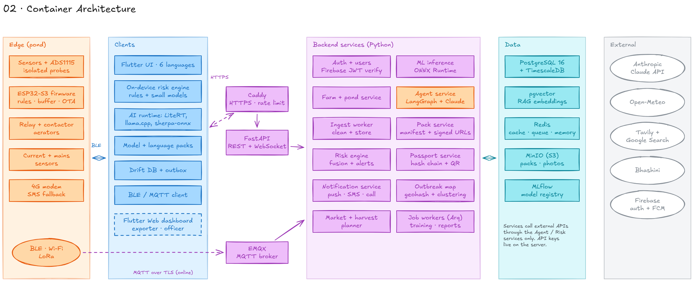

### 3.2 Data pipeline

Sensor readings travel over MQTT to an ingest worker. They are validated and quality-checked, stored in a TimescaleDB hypertable, rolled up into 5-minute, hourly and daily aggregates, then turned into model features. Bad readings are flagged, never silently dropped.

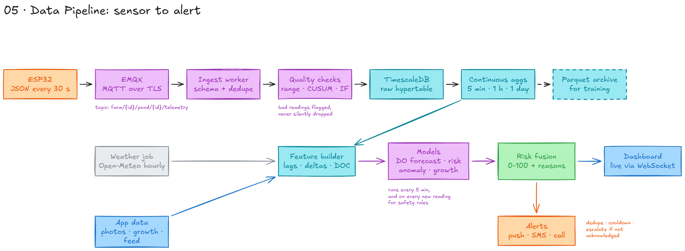

### 3.3 Database schema

One PostgreSQL database holds relational data, time-series data (TimescaleDB) and vector embeddings for the knowledge base (pgvector). Every table carries `created_at`, `updated_at` and a `version` column used for offline sync merges.

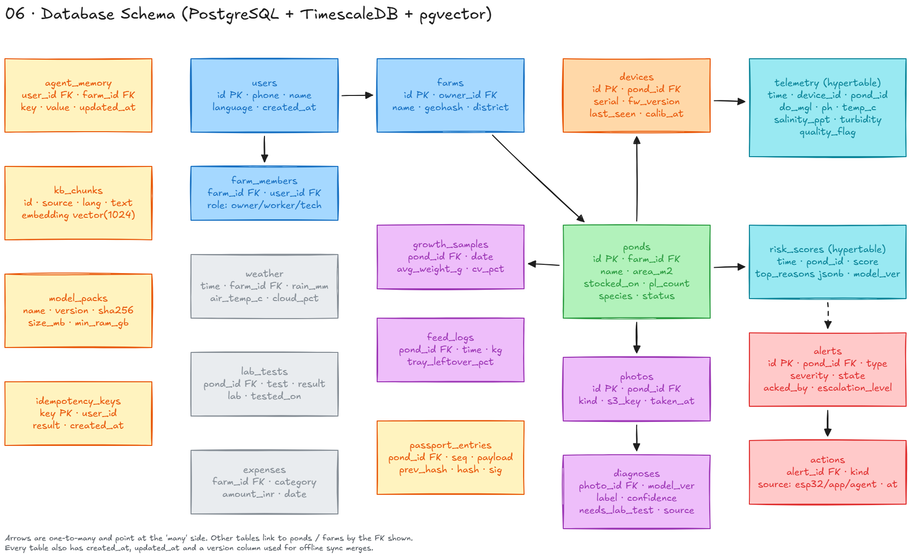

---

## 4. How the main flows work

### 4.1 App user flow

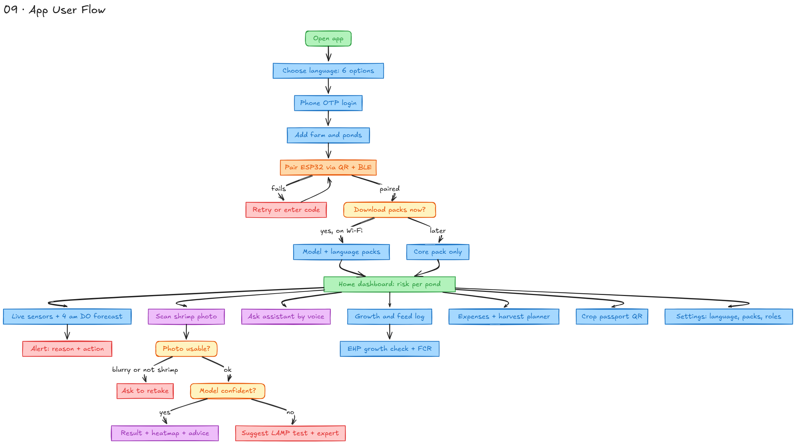

### 4.2 Offline sync (outbox pattern)

Every change is written to the phone's database first, together with an idempotency key, so the farmer never waits for the network. A sync worker pushes the outbox when the connection returns and pulls server changes using a cursor. Sending the same key twice never creates a duplicate.

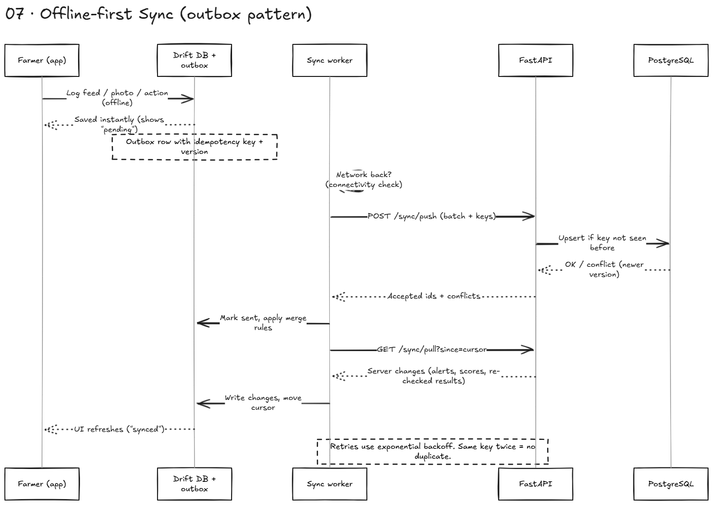

### 4.3 Alert lifecycle

Alerts are deduplicated, escalate from push to SMS to a phone call if nobody acknowledges them, and close only when the condition has been stable for 30 minutes. Critical oxygen events are handled locally by the ESP32 before the cloud is involved.

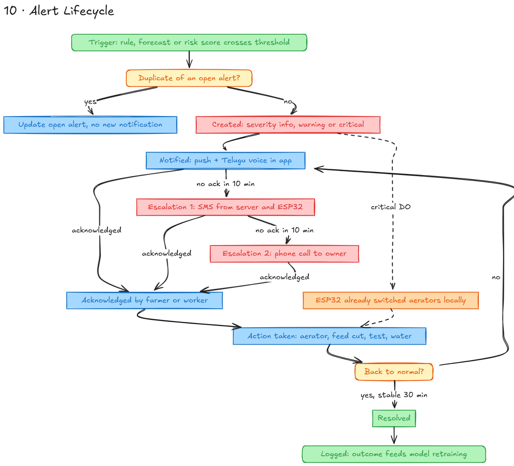

### 4.4 Night oxygen forecast and aerator control

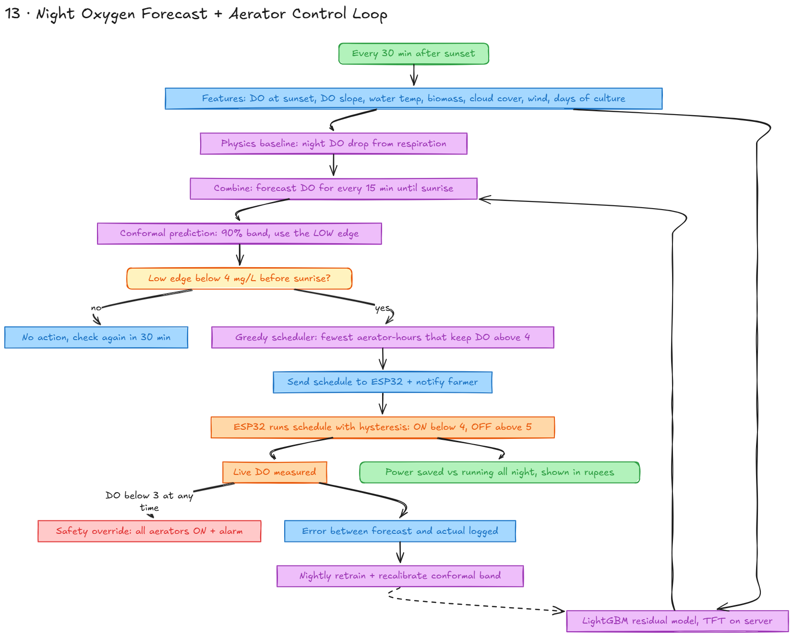

### 4.5 Disease detection from a photo

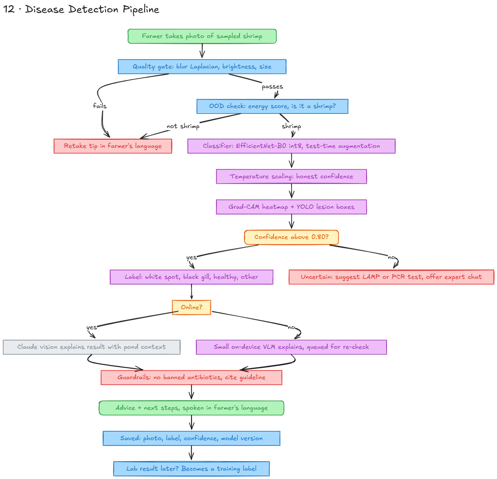

---

## 5. AI and machine learning

### 5.1 Model map

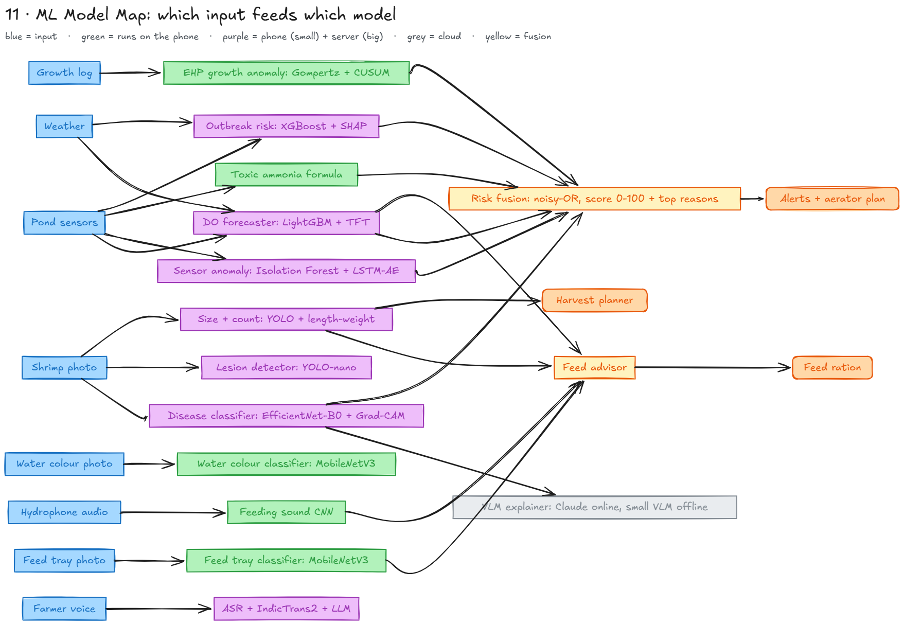

### 5.2 Models

| Model | Task | On the phone | On the server |
|---|---|---|---|
| Disease classifier | Healthy / white spot / black gill / other | EfficientNet-B0 or MobileNetV3, int8 [M1][M2] | ConvNeXt-Tiny |
| Lesion detector | Boxes around lesions | YOLO-nano | Larger YOLO or U-Net |
| Size and count | Shrimp count and length, converted to weight with W = a·L^b | YOLO-nano + regressor | Same, larger |
| Water colour classifier | Plankton / bloom type | MobileNetV3-Small | Same |
| Feed tray classifier | Leftover feed level | MobileNetV3-Small | Same |
| DO forecaster | Night DO forecast | LightGBM [M3] or tiny GRU | Temporal Fusion Transformer [M4] |
| Sensor anomaly | Odd readings | Isolation Forest [M5] | LSTM autoencoder |
| Outbreak risk | 48-hour risk | XGBoost [M6] + SHAP [M7] | Same; graph neural network later |
| Feeding sound | Feeding activity from audio | Small CNN on mel-spectrograms | Same |
| Out-of-distribution check | Rejects photos that are not shrimp | Energy score [M8] | Same |
| Vision-language explainer | Explains a photo result | Small VLM (SmolVLM / Moondream class) | Claude (vision) |
| Assistant LLM | Conversation and tool use | 1B model, 4-bit GGUF, LoRA-tuned [M9] | Claude Opus 5.5 |
| Embeddings | Knowledge search | multilingual-e5-small | bge-m3 [M10] |
| Speech-to-text | Voice input | Whisper-small [M11] or Conformer-based IndicConformer [M12] via sherpa-onnx | Bhashini |
| Text-to-speech | Voice output | VITS-based Indic voices via sherpa-onnx | Bhashini |
| Translation | Language bridge | IndicTrans2, distilled [M13] | IndicTrans2, full |
| Voice activity detection | Detects speech start and end | Silero VAD | — |

### 5.3 Neural network architectures

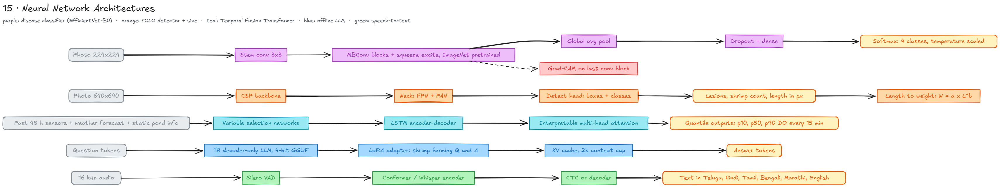

### 5.4 Algorithms

<details>
<summary><b>Sensor data</b></summary>

- **Calibration:** two-point pH; DO compensated for temperature and salinity using the Garcia–Gordon oxygen solubility equations [M14]; salinity from conductivity using the PSS-78 standard.
- **Filtering:** median filter for spikes, then a Kalman filter [M15].
- **Fault detection:** range and stuck-value checks, CUSUM for slow drift [M16], Isolation Forest or an LSTM autoencoder for unusual combinations.
- **Missing data:** short gaps interpolated; long gaps flagged, never invented.

</details>

<details>
<summary><b>Oxygen and aerators</b></summary>

- **Forecast:** a physics baseline for night-time respiration plus a LightGBM residual model (TFT on the server). It predicts the low end of the range so it errs on the safe side.
- **Uncertainty:** split conformal prediction gives a calibrated 90% band; decisions use its lower edge [M17].
- **Scheduling:** a greedy scheduler finds the fewest aerator-hours that keep DO above 4 mg/L (the critical level used in [R12]). Hysteresis (on below 4, off above 5) prevents relay chatter.
- **Safety override:** the ESP32 always switches aerators on if live DO drops below 3 mg/L. Cloud commands cannot override this.

</details>

<details>
<summary><b>Disease and growth</b></summary>

- **Photo pipeline:** quality gate, then out-of-distribution rejection [M8], then the classifier with test-time augmentation, then temperature scaling so the confidence is honest [M18], then a Grad-CAM heatmap [M19].
- **Training:** transfer learning, strong augmentation, focal loss for class imbalance [M20], cross-validation split by farm.
- **Outbreak risk:** XGBoost on stress features (24-hour temperature change, salinity change, rainfall, minimum DO, pH swing, toxic ammonia, days of culture, neighbour reports), explained with SHAP. Until enough labelled outbreaks exist, it starts as an expert-weighted score based on the stressors in [R6][R7].
- **EHP:** expected growth from a Gompertz / von Bertalanffy curve; flags low average daily gain, a widening size spread, and CUSUM drift between actual and expected weight [R8][R9].
- **Toxic ammonia:** un-ionized ammonia fraction from pH, temperature and salinity, following the US EPA saltwater ammonia method [R13].

</details>

<details>
<summary><b>Fusion, feed and harvest</b></summary>

- **Risk fusion:** sub-risks combined with a noisy-OR into one 0–100 score plus the top three reasons.
- **Alert logic:** severity levels, deduplication, cooldown and escalation.
- **Feed:** a standard feed table by average body weight, adjusted for DO, temperature and tray leftovers; a contextual bandit learns per pond later.
- **Harvest planner:** growth forecast × price forecast × disease risk, choosing the date with the best expected profit.

</details>

<details>
<summary><b>Platform</b></summary>

- **Offline sync:** outbox pattern, idempotency keys, last-write-wins with per-field merge, exponential backoff.
- **Pack delivery:** version manifest, SHA-256 check, resumable chunked downloads, device capability scoring.
- **Outbreak map privacy:** geohash grid with k-anonymity (an area is shown only when it holds at least 5 farms) and ST-DBSCAN to find clusters [M21]. Inspired by the Ecuador shrimp early-warning system [R14].
- **Crop passport:** hash-chained log with an Ed25519 signature. Tamper-evident without a blockchain.

</details>

### 5.5 MLOps

Data is split **by farm, not by photo**, so the evaluation reflects farms the model has never seen. A model is promoted only if it beats the current one, then it is compressed (distillation [M22], pruning, int8 or 4-bit quantization), exported to ONNX, LiteRT or GGUF, shadow-tested, and rolled out to 10% of farms first.

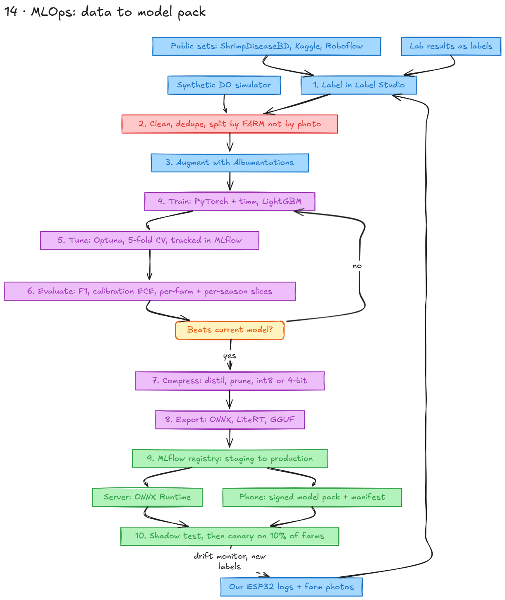

---

## 6. The AI assistant (Claude)

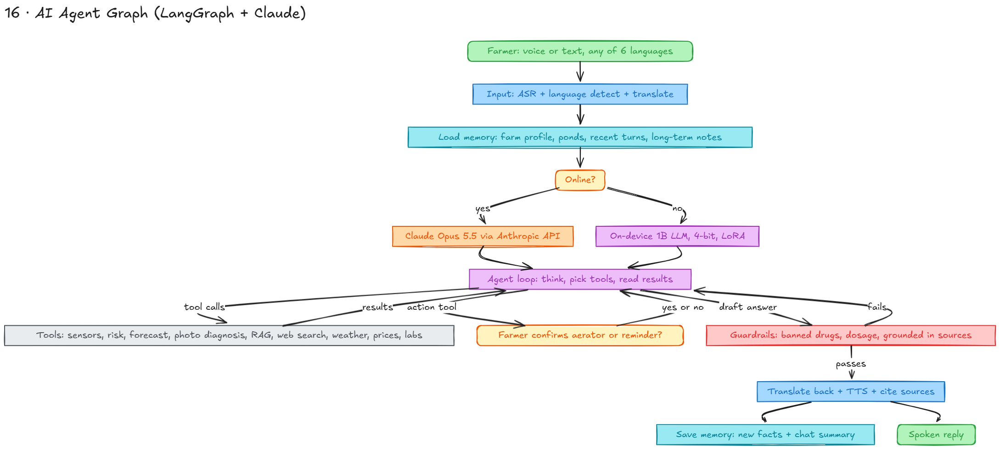

The assistant is a LangGraph agent following a ReAct-style loop [M23]: it thinks, calls tools, reads the results and answers.

| Concern | Choice |
|---|---|
| Online model | **Claude Opus 5.5** (`claude-opus-5-5`) through the Anthropic API, using the official `anthropic` Python SDK |
| Reasoning | Adaptive thinking (`thinking: {type: "adaptive"}`), effort set per route |
| Long answers | Streaming responses |
| Cost and speed | Prompt caching on the stable system prompt and tool definitions |
| Long chats | Server-side compaction (beta) so conversations can run past the context window |
| Memory | Short-term chat context; long-term farm facts stored in Postgres (`agent_memory`) and exposed through Claude's memory tool (`memory_20250818`); rolling summaries of long chats |
| Web search | Claude's server-side web search tool (`web_search_20260209`), plus Tavily and Google Programmable Search as extra tools |
| Reliability | Server-side refusal fallbacks enabled; retries with backoff on rate limits |
| Offline model | 1B-class open model, LoRA-tuned on shrimp-farming Q&A distilled from Claude, quantized to 4-bit GGUF, run with llama.cpp |
| Key handling | `ANTHROPIC_API_KEY` lives only on the server. The app never sees it. |

**Tools available to the agent**

| Tool | What it does | Needs confirmation |
|---|---|---|
| `get_sensor_data` | Latest and historical readings for a pond | No |
| `get_risk_score` | Current risk score with top reasons | No |
| `get_do_forecast` | Tonight's oxygen forecast and band | No |
| `diagnose_photo` | Runs the disease pipeline on a photo | No |
| `knowledge_base` | RAG search over ICAR-CIBA, MPEDA, CAA and FAO guidance | No |
| `web_search` | Claude web search, Tavily, Google | No |
| `weather_forecast` | Open-Meteo forecast for the farm | No |
| `market_price` / `find_lab` | Prices and nearby testing labs | No |
| `control_aerator` | Switches aerators through the ESP32 | **Yes** |
| `set_reminder` / `log_entry` | Tasks and farm log entries | **Yes** |
| `crop_passport` | Adds an entry or shows the QR | **Yes** |

**Guardrails** block advice involving banned antibiotics (for example chloramphenicol and nitrofurans, banned in Indian aquaculture since 2025 [R4]), check dosages against the knowledge base, and require sources for factual claims.

### 6.1 Knowledge pipeline (RAG)

Retrieval-augmented generation [M24] with hybrid search (BM25 plus vectors), a reranker, and answers grounded only in the retrieved chunks.

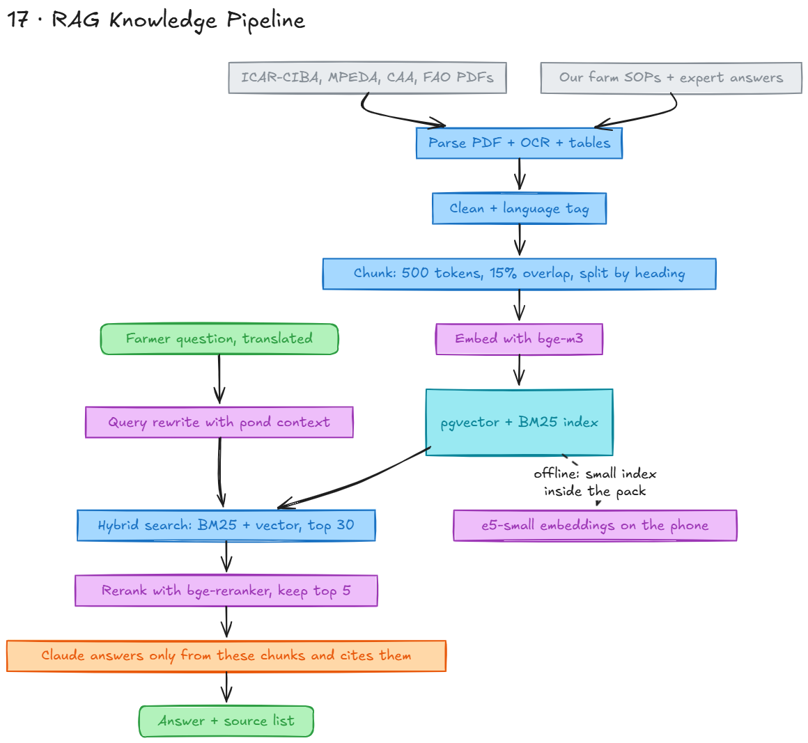

### 6.2 Voice pipeline

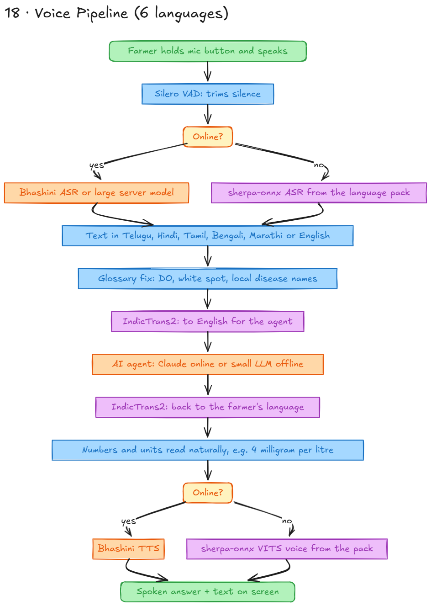

---

## 7. Offline-first and downloadable packs

Like offline maps in a game, farmers download packs once over Wi-Fi and the app keeps working without internet. The ESP32 safety rules never depend on the phone or the network.

| Pack | Contents | Approx. size | Default |
|---|---|---|---|
| Core | Disease classifier, DO forecaster, risk engine, toxic ammonia, EHP check | 10–30 MB | Bundled with the app |
| Language (one per language) | Speech-to-text, text-to-speech, translation | 150–400 MB | Optional |
| Assistant | 1B LLM (4-bit) + small knowledge index | 0.7–1 GB | Optional |
| Vision explainer | Small VLM | 0.5–2 GB | Optional; phones with 6 GB+ RAM |

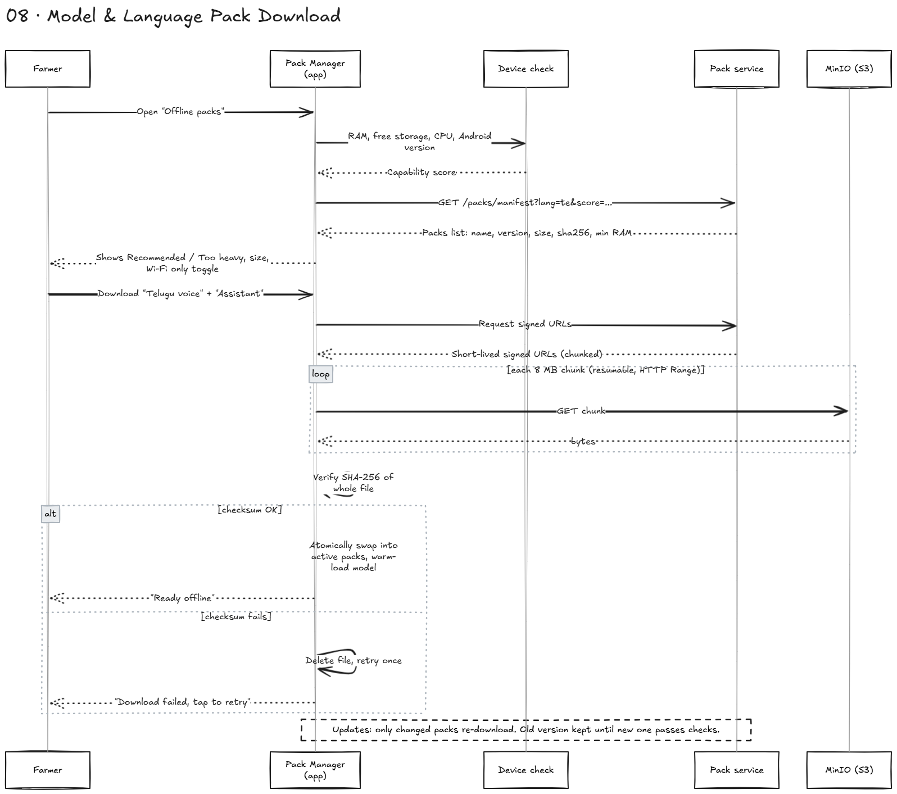

When the phone is back online, answers produced offline are re-checked by the larger server models, and the farmer is notified if a result changes.

---

## 8. Languages

Hindi, Telugu, Tamil, Bengali, Marathi and English.

- App text is bundled for all six languages (Flutter ARB files with Noto fonts).
- Voice works offline once that language pack is downloaded, and always works online.
- Offline, a small LLM answers in English and IndicTrans2 translates in and out, so one translation model covers every language.
- A per-language glossary keeps terms like "DO", "white spot" and local disease names correct in speech recognition.
- Alert texts are reviewed by native speakers before release.

---

## 9. Hardware

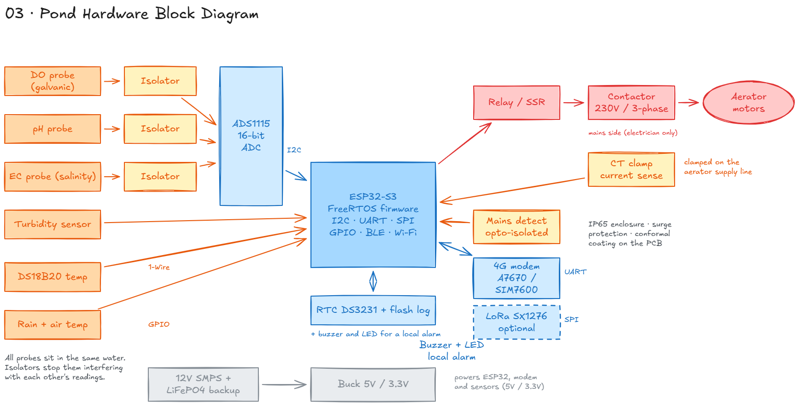

### 9.1 Bill of materials (per pond node)

| Part | Example | Purpose |
|---|---|---|
| Controller | ESP32-S3 dev board | Sensors, rules, BLE, Wi-Fi, MQTT |
| DO probe | Galvanic DO probe (for example DFRobot Gravity DO) | Dissolved oxygen |
| pH probe | Industrial pH probe + Gravity pH board | pH |
| EC probe | Gravity EC (K=10 for brackish water) | Salinity |
| Temperature | DS18B20 waterproof | Water temperature |
| Turbidity | Analog turbidity sensor | Turbidity |
| Rain + air temperature | Rain sensor + air temperature sensor | White spot trigger detection offline |
| ADC | ADS1115 16-bit | Precise analog readings |
| Isolators | Analog signal isolators, one per probe | Stops probes in the same water interfering with each other |
| Aerator switching | Relay or SSR driving a contactor | Aerator motors draw too much current for a bare relay |
| Current sensor | CT clamp | Detects a stopped or failing aerator |
| Mains detection | Opto-isolated AC detector | Power-cut alerts |
| Cellular | 4G module (A7670 / SIM7600) | SMS alerts without internet; SIM800L is 2G-only and 2G coverage is shrinking |
| Long range (optional) | LoRa SX1276 | Ponds far from the house |
| Time and storage | DS3231 RTC + on-board flash | Timestamps and an offline buffer |
| Power | 12 V SMPS + LiFePO4 backup + buck converters | Keeps running through power cuts |
| Enclosure | IP65 box, surge protection, conformal coating | Survives a pond-side environment |

> Mains wiring for the contactor and aerators must be done by a licensed electrician.

### 9.2 Firmware

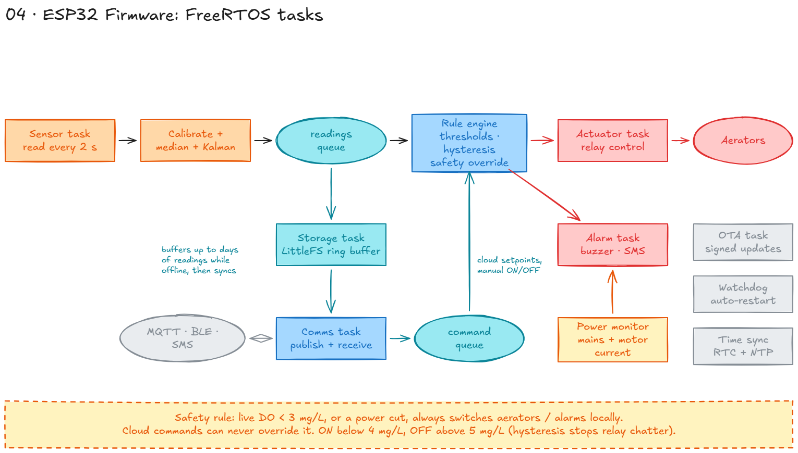

---

## 10. Tech stack

| Layer | Technology |
|---|---|
| Firmware | PlatformIO, Arduino framework on FreeRTOS, MQTT over TLS, BLE GATT, OTA updates |
| Mobile app | Flutter, Riverpod, go_router, Drift (SQLite) + SQLCipher, flutter_blue_plus, mqtt_client, dio, background_downloader, WorkManager, fl_chart, flutter_intl |
| On-device AI | LiteRT (TFLite), ONNX Runtime, llama.cpp, sherpa-onnx |
| Web dashboard | Flutter Web |
| Backend | Python, FastAPI, Pydantic, SQLAlchemy, Arq workers, WebSockets |
| AI agent | LangGraph + Anthropic Python SDK (Claude Opus 5.5) |
| IoT broker | EMQX |
| Databases | PostgreSQL 16 + TimescaleDB + pgvector, Redis |
| Object storage | MinIO (S3-compatible) |
| Auth and push | Firebase Auth (phone OTP), Firebase Cloud Messaging |
| External APIs | Anthropic, Open-Meteo, Tavily, Google Programmable Search, Bhashini |
| ML training | PyTorch, timm, Albumentations, LightGBM, XGBoost, scikit-learn, Optuna, SHAP, MLflow, PEFT / Unsloth, llama.cpp quantization |
| DevOps | Docker Compose, Caddy, GitHub Actions, Prometheus, Grafana, Sentry |

---

## 11. Datasets

| Need | Source | Notes |
|---|---|---|
| Disease photos | ShrimpDiseaseBD, 1,149 images at 2048×2048 [R15] | Public |
| More disease photos | Kaggle, Roboflow Universe, Mendeley Data | Check each licence and label quality before use |
| Water quality | Kaggle aquaculture / IoT pond datasets | Mostly fish ponds; used for pre-training only |
| Our sensor logs | AquaSentinel ESP32 nodes, from day one | The most valuable dataset |
| Synthetic sensor data | Physics-based simulator of the daily DO cycle | Pre-trains the forecaster before real data exists |
| Weather history | Open-Meteo historical API (ERA5 reanalysis) | Free, hourly, any location |
| Growth curves | Published L. vannamei growth studies + farm records | EHP baseline |
| Knowledge base | ICAR-CIBA, MPEDA, Coastal Aquaculture Authority, FAO publications | Feeds the RAG index |
| Speech-to-text | AI4Bharat IndicVoices and Kathbath, Google FLEURS | Indian-language speech |
| Text-to-speech | IIT Madras IndicTTS | Indian-language voices |
| Translation | BPCC (the IndicTrans2 training corpus) | |
| LLM fine-tuning | Q&A generated by Claude from the knowledge base, checked by people | Distillation data |
| Water colour, feed tray and size photos | Collected by the team with labels | No good public sets exist |

> **Licences matter.** Some popular models are not free for commercial use (for example Meta's MMS speech models are non-commercial) and the Ultralytics YOLO code is AGPL-3.0. Check every dataset and model licence before shipping.

---

## 12. Security and the crop passport

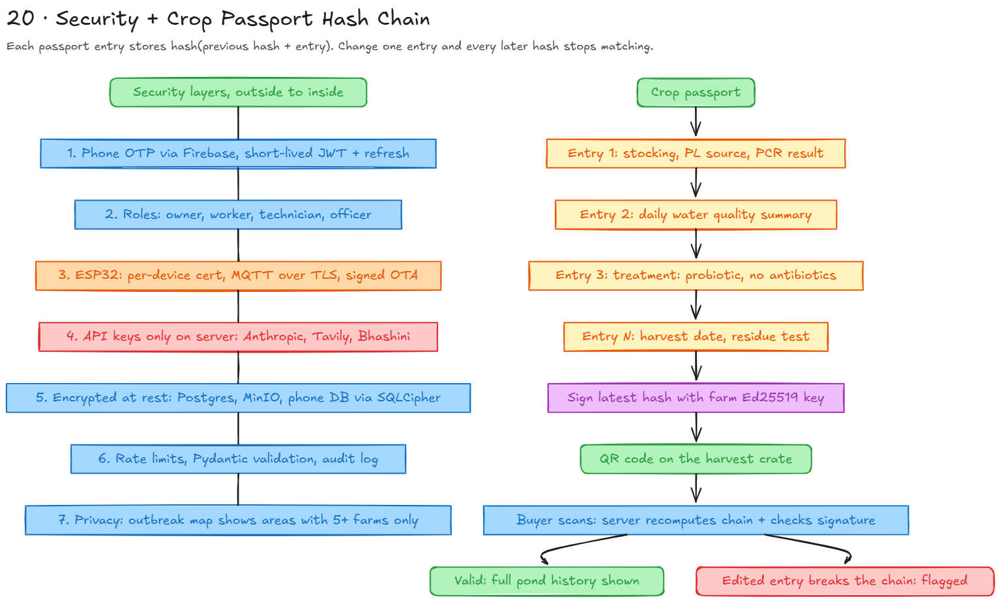

- Phone OTP login, short-lived JWTs and role-based access.
- Each ESP32 has its own certificate; MQTT runs over TLS; firmware updates are signed.
- All third-party API keys stay on the server.
- Data is encrypted at rest on the server and on the phone.
- The outbreak map never reveals an individual farm.
- The crop passport is a hash chain signed with the farm's Ed25519 key. If any entry is edited, verification fails.

---

## 13. Deployment

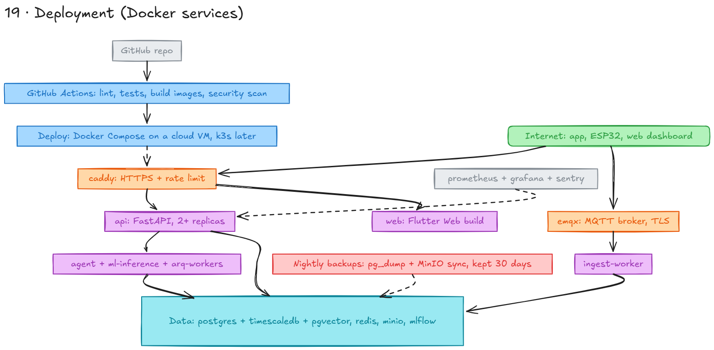

The whole backend runs with Docker Compose on a single cloud VM to start, and can move to k3s later. CI runs linting, tests, image builds and a security scan on every push. Postgres and MinIO are backed up nightly and kept for 30 days.

---

## 14. Repository layout

This is the planned structure:

```
aquasentinel/
├── firmware/            # ESP32-S3 PlatformIO project
├── app/                 # Flutter mobile app (+ web dashboard target)
├── backend/
│   ├── api/             # FastAPI service
│   ├── agent/           # LangGraph + Claude agent and tools
│   ├── ingest/          # MQTT ingest worker
│   ├── workers/         # Arq jobs: risk, alerts, reports, retraining
│   └── ml_inference/    # ONNX Runtime model server
├── ml/
│   ├── notebooks/
│   ├── training/        # training and evaluation scripts
│   ├── export/          # ONNX / LiteRT / GGUF export and quantization
│   └── packs/           # model pack manifests
├── knowledge/           # source documents for the RAG index
├── infra/               # docker-compose, Caddyfile, EMQX config, CI
└── docs/diagrams/       # all diagrams (.png)
```

---

## 15. Getting started

The project is at the design stage. Code is not in the repository yet, so the steps below describe the intended setup.

**Prerequisites:** Docker and Docker Compose, Flutter SDK, Python 3.11+, PlatformIO, an Anthropic API key, a Firebase project.

1. Copy the environment template and fill in your keys:

   ```bash
   cp infra/.env.example infra/.env
   ```

   ```dotenv
   ANTHROPIC_API_KEY=your-key-here      # server only, never put this in the app
   TAVILY_API_KEY=your-key-here
   GOOGLE_CSE_ID=your-id
   GOOGLE_API_KEY=your-key-here
   BHASHINI_API_KEY=your-key-here
   FIREBASE_PROJECT_ID=your-project
   POSTGRES_PASSWORD=change-me
   MINIO_ROOT_PASSWORD=change-me
   ```

2. Start the backend:

   ```bash
   docker compose -f infra/docker-compose.yml up -d
   ```

3. Run the app:

   ```bash
   cd app && flutter pub get && flutter run
   ```

4. Flash the ESP32:

   ```bash
   cd firmware && pio run -t upload
   ```

5. Pair the device from the app by scanning the QR code on the enclosure.

---

## 16. Roadmap

- [ ] Hardware node: sensors, calibration, relay control, SMS
- [ ] Firmware safety rules and offline buffering
- [ ] Backend: ingest, storage, risk engine, alerts
- [ ] Flutter app: dashboard, alerts, photo scan, logs, offline sync
- [ ] Disease classifier trained and exported to LiteRT
- [ ] DO forecaster trained on simulated data, then real pond data
- [ ] Claude agent with tools, memory and RAG
- [ ] Language packs for all six languages
- [ ] Crop passport and exporter dashboard
- [ ] Neighbourhood outbreak map
- [ ] Field pilot on partner farms

---

## 17. References and research credits

Figures quoted in this README come from the sources below. Please read the original before quoting a number.

### Problem and domain research

- **[R1]** National survey of infectious disease losses in Indian shrimp farming (909 farms, 23 coastal districts), *Aquaculture* (2020). ICAR repository: https://krishi.icar.gov.in/jspui/handle/123456789/43787
- **[R2]** Economic burden of diseases in aquatic animal food production in India. ICAR-CMFRI: https://eprints.cmfri.org.in/18644/
- **[R3]** Study of Pacific white shrimp (L. vannamei) production and state-wise share, citing MPEDA data (AJAEES, 2021): https://ageconsearch.umn.edu/record/358126/files/Narkis39102021AJAEES75289.pdf
- **[R4]** Andhra farms drove 74% of India's antibiotic shrimp rejections (The South First, 2026): https://thesouthfirst.com/health/andhra-farms-drove-74-of-indias-antibiotic-shrimp-rejections-centre-seeks-answers-from-states/
- **[R5]** Automated dissolved oxygen sensing and aerator activation in aquaculture (Global Seafood Alliance): https://www.globalseafood.org/advocate/automated-dissolved-oxygen-sensing-and-aerator-activation-in-aquaculture/
- **[R6]** Influence of stressors on shrimp susceptibility to white spot disease, part 1 (Global Seafood Alliance): https://www.globalseafood.org/advocate/influence-of-stressors-on-shrimp-susceptibility-to-white-spot-disease-part-1/
- **[R7]** Tendencia, E. A. and Verreth, J. A. J., temperature fluctuation, low salinity and water microflora as risk factors for WSSV outbreaks in stocked shrimp ponds (2011), SEAFDEC/AQD. Summarised in [R6].
- **[R8]** ICAR-CIBA, Hepatopancreatic microsporidiosis (EHP) advisory: https://ciba.icar.gov.in/wp-content/uploads/2020/06/Hepatopancreatic-Microsporidiosis.pdf
- **[R9]** Robins McIntosh on EHP and shrimp farming, part 1 (Global Seafood Alliance): https://www.globalseafood.org/advocate/robins-mcintosh-on-everything-you-need-to-know-about-ehp-and-shrimp-farming-part-1/
- **[R12]** LSTM-based dissolved oxygen prediction for aquaculture aerator control, *Mathematical Biosciences and Engineering* 16(4) (2019): https://aimspress.com/aimspress-data/mbe/2019/4/PDF/mbe-16-04-148.pdf
- **[R13]** US EPA, Ambient water quality criteria for ammonia (saltwater), 1989: https://www.epa.gov/sites/default/files/2019-02/documents/ambient-wqc-ammonia-saltwater-1989.pdf
- **[R14]** Bayot et al., GIS-based regional alert system for shrimp diseases in Ecuador (2008): https://www.cenaim.espol.edu.ec/sites/cenaim.espol.edu.ec/files/Bayot.pdf

### Shrimp AI and monitoring research

- **[R10]** A multi-stage deep learning framework for automated detection and localization of shrimp disease (ConvNeXt-Tiny, U-Net++, Grad-CAM), BRAC University (2026): https://dspace.bracu.ac.bd/items/9c2ed61e-c2d4-422b-8ec5-045f648377a0
- **[R11]** Multi-class shrimp disease classification with explainable AI (Dual-Xception), Daffodil International University: https://research.daffodilvarsity.edu.bd/scopus-article/6713
- **[R15]** ShrimpDiseaseBD dataset, East West University: https://aquahoy.com/?p=50410
- **[R16]** A deep residual learning framework using ResNet-152 for multi-class classification of shrimp diseases, *Indian Journal of Animal Research*: https://arccjournals.com/journal/indian-journal-of-animal-research/BF-2100
- **[R17]** DenseNet201-based white spot syndrome detection, *Indian Journal of Animal Research*: https://arccjournals.com/journal/indian-journal-of-animal-research/BF-1947
- **[R18]** Application of artificial intelligence to automatic disease recognition in black tiger shrimp (EfficientNet-B4): https://vjol.info.vn/tckhcnthuysan/article/view/134418
- **[R19]** Nguyen et al., Deep learning approach for forecasting water quality in IoT systems (LSTM), 2020: https://archimer.ifremer.fr/doc/00646/75836
- **[R20]** EMD-RF-LSTM: combination prediction model of dissolved oxygen concentration in prawn culture, *Smart Agriculture* 3(2) (2021): https://doaj.org/article/35a84d9b883c4d0eb40405964e4ce369
- **[R21]** Image technology based detection of infected shrimp in adverse environments, *Songklanakarin J. Sci. Technol.* (2022): https://doaj.org/article/69e782acbfc743df9e639e939b3aaf30
- **[R22]** Underwater video monitoring of shrimp in turbid ponds, *Scientific Reports* (2016): https://www.nature.com/articles/srep31810
- **[R23]** Kumar et al., field-portable closed-tube LAMP for WSSV, ICAR-CIBA: https://ciba.res.in/?p=18287
- **[R24]** Sullivan et al., CRISPR/SHERLOCK single-copy detection of white spot syndrome virus, *Scientific Reports* (2019): https://pmc.ncbi.nlm.nih.gov/articles/PMC6928230
- **[R25]** Acoustic control improves feeding productivity at shrimp farms (Global Seafood Alliance): https://www.globalseafood.org/advocate/acoustic-control-improves-feeding-productivity-at-shrimp-farms/

### Methods

- **[M1]** Tan, M. and Le, Q. V., EfficientNet: Rethinking Model Scaling for CNNs, ICML 2019. https://arxiv.org/abs/1905.11946
- **[M2]** Howard, A. et al., Searching for MobileNetV3, ICCV 2019. https://arxiv.org/abs/1905.02244
- **[M3]** Ke, G. et al., LightGBM: A Highly Efficient Gradient Boosting Decision Tree, NeurIPS 2017.
- **[M4]** Lim, B. et al., Temporal Fusion Transformers for Interpretable Multi-horizon Time Series Forecasting, 2021. https://arxiv.org/abs/1912.09363
- **[M5]** Liu, F. T., Ting, K. M. and Zhou, Z.-H., Isolation Forest, ICDM 2008.
- **[M6]** Chen, T. and Guestrin, C., XGBoost: A Scalable Tree Boosting System, KDD 2016. https://arxiv.org/abs/1603.02754
- **[M7]** Lundberg, S. and Lee, S.-I., A Unified Approach to Interpreting Model Predictions (SHAP), NeurIPS 2017. https://arxiv.org/abs/1705.07874
- **[M8]** Liu, W. et al., Energy-based Out-of-distribution Detection, NeurIPS 2020. https://arxiv.org/abs/2010.03759
- **[M9]** Hu, E. et al., LoRA: Low-Rank Adaptation of Large Language Models, 2021. https://arxiv.org/abs/2106.09685
- **[M10]** Chen, J. et al., BGE M3-Embedding, 2024. https://arxiv.org/abs/2402.03216
- **[M11]** Radford, A. et al., Robust Speech Recognition via Large-Scale Weak Supervision (Whisper), 2022. https://arxiv.org/abs/2212.04356
- **[M12]** Gulati, A. et al., Conformer: Convolution-augmented Transformer for Speech Recognition, 2020. https://arxiv.org/abs/2005.08100
- **[M13]** Gala, J. et al., IndicTrans2: Towards High-Quality and Accessible Machine Translation Models for all 22 Scheduled Indian Languages, 2023. https://arxiv.org/abs/2305.16307
- **[M14]** Garcia, H. E. and Gordon, L. I., Oxygen solubility in seawater: better fitting equations, *Limnology and Oceanography* 37(6), 1992.
- **[M15]** Kalman, R. E., A New Approach to Linear Filtering and Prediction Problems, 1960.
- **[M16]** Page, E. S., Continuous Inspection Schemes (CUSUM), *Biometrika*, 1954.
- **[M17]** Angelopoulos, A. N. and Bates, S., A Gentle Introduction to Conformal Prediction and Distribution-Free Uncertainty Quantification, 2021. https://arxiv.org/abs/2107.07511
- **[M18]** Guo, C. et al., On Calibration of Modern Neural Networks, ICML 2017. https://arxiv.org/abs/1706.04599
- **[M19]** Selvaraju, R. R. et al., Grad-CAM: Visual Explanations from Deep Networks, ICCV 2017. https://arxiv.org/abs/1610.02391
- **[M20]** Lin, T.-Y. et al., Focal Loss for Dense Object Detection, ICCV 2017. https://arxiv.org/abs/1708.02002
- **[M21]** Birant, D. and Kut, A., ST-DBSCAN: An algorithm for clustering spatial–temporal data, *Data & Knowledge Engineering*, 2007.
- **[M22]** Hinton, G., Vinyals, O. and Dean, J., Distilling the Knowledge in a Neural Network, 2015. https://arxiv.org/abs/1503.02531
- **[M23]** Yao, S. et al., ReAct: Synergizing Reasoning and Acting in Language Models, 2022. https://arxiv.org/abs/2210.03629
- **[M24]** Lewis, P. et al., Retrieval-Augmented Generation for Knowledge-Intensive NLP Tasks, NeurIPS 2020. https://arxiv.org/abs/2005.11401

### Acknowledgements

Thanks to ICAR-CIBA, ICAR-CMFRI, MPEDA, SEAFDEC/AQD and AI4Bharat for the public research, advisories and open models this project builds on.

---

## 18. License

To be decided by the team. MIT is suggested for the code. Datasets and third-party models keep their own licences (see [Datasets](#11-datasets)).

---

<sub>All diagrams are in `docs/diagrams/` and were drawn with Excalidraw.</sub>
