# AquaSentinel

**A pond-to-port health and compliance system for shrimp farms.** AquaSentinel watches pond water with real sensors, keeps aerators running even when the internet is down, and keeps a tamper-evident record of every treatment and lab result, so a harvest that would carry banned-drug residue is blocked before it leaves the farm.

> **Status: design stage.** There is no code in this repository yet. Everything below is a proposed design, not a validated product. Claims about regulations and competitors were checked against public sources on 21 Oct 2026 (see [References](#references)); items that still need primary documents are listed in [Open items](#open-items).

---

## Contents

1. [The problem](#1-the-problem)
2. [What AquaSentinel does and does not claim](#2-what-aquasentinel-does-and-does-not-claim)
3. [How it works](#3-how-it-works)
4. [Architecture](#4-architecture)
5. [Edge safety: protecting the pond](#5-edge-safety-protecting-the-pond)
6. [Compliance: protecting the harvest](#6-compliance-protecting-the-harvest)
7. [Lots, evidence and trust](#7-lots-evidence-and-trust)
8. [The event log](#8-the-event-log)
9. [Who uses it](#9-who-uses-it)
10. [Features and roadmap](#10-features-and-roadmap)
11. [Security and privacy](#11-security-and-privacy)
12. [Pilot plan](#12-pilot-plan)
13. [Planned repository layout](#13-planned-repository-layout)
14. [Open items](#open-items)
15. [References](#references)
16. [License](#license)

**Diagram index**

| # | Diagram | Section |
|---|---|---|
| 01 | Two independent paths | 3 |
| 02 | System context | 4.1 |
| 03 | Container architecture | 4.2 |
| 04 | Pond node hardware | 4.3 |
| 05 | Edge safety loop | 5 |
| 06 | Alert lifecycle | 5 |
| 07 | Treatment to passport flow | 6.1 |
| 08 | Harvest gate decision logic | 6.2 |
| 09 | Harvest gate states | 6.2 |
| 10 | Rule packs | 6.3 |
| 11 | Certificate lifecycle | 6.4 |
| 12 | Lot lineage | 7.1 |
| 13 | Evidence types | 7.2 |
| 14 | Invoice reconciliation | 7.3 |
| 15 | Sensor reading to event | 8 |
| 16 | Event ingestion path | 8 |
| 17 | Event envelope and clocks | 8 |
| 18 | Hash chains and anchoring | 8 |
| 19 | Offline sync | 8 |
| 20 | Roles and consent | 9 |
| 21 | Privacy boundaries | 11 |

Diagrams are PNGs in `docs/diagrams/`, with editable Graphviz sources in `docs/diagrams/src/`. Colour key: green is people on the farm, orange is pond hardware, blue is the platform, purple is outside parties, grey is storage and infrastructure, yellow is a decision or review state, red is a block or alert.

---

## 1. The problem

Disease is the biggest money leak in Indian shrimp farming, and it leads to a second problem: **panic treatment with banned antibiotics, then export rejection.**

| Fact | Figure | Source |
|---|---|---|
| Probability a surveyed farm had an infectious disease (909 farms, 23 coastal districts) | 49%, costing about 0.21 million tonnes and US$1.02 billion a year | ICAR survey |
| 2025 EU, US and Japan shrimp rejections linked to chloramphenicol and nitrofuran residues | 43% of rejections, traced to 40+ farms | MPEDA, via a CDSCO letter |
| Share of those implicated farms in Andhra Pradesh | 74% (Odisha 13%, West Bengal 8.7%, Gujarat 4.3%) | MPEDA, via press reports |
| Antibiotic-related US shrimp refusals from BAP-certified facilities, Q1 2026 | 85.7% | Southern Shrimp Alliance analysis (a US industry group, so treat as an advocacy figure) |

Three things make this hard to fix:

1. **Visible symptoms appear late.** Photo-based disease detection is triage, not diagnosis. PCR confirms pathogens, but PCR is not a residue test.
2. **Residue tests are a different assay.** India's pre-harvest test uses ELISA screening, with positives confirmed by LC-MS/MS. It is mandatory only for EU-bound shrimp, and a negative result clears only the compounds tested.
3. **Paper certification does not catch violations.** A paper trail proves what someone wrote, not what happened in the pond.

Note on the 74%: it is Andhra Pradesh's share of the **implicated farms**, not of rejections, although some headlines say otherwise.

---

## 2. What AquaSentinel does and does not claim

**It claims** to reduce compliance risk and improve traceability by:

- giving earlier warning of low oxygen and equipment failure,
- keeping a tamper-evident ledger of treatments and lab evidence,
- enforcing withdrawal periods with a deterministic rule engine,
- gating harvests so unclear or failing evidence never turns green, and
- giving exporters lot-level evidence they can verify.

**It does not claim** to:

- guarantee residue-free shrimp. A complete digital record is not proof of physical safety.
- replace government testing or clearance. A certificate is AquaSentinel evidence, not a government clearance.
- let AI decide. AI reads labels, flags risks and explains results. It never clears a harvest, and it never recommends drugs or doses.
- call a crop "antibiotic-free". The passport states the evidence held and whether it is independently verified.

A hash chain proves a record was not changed after it was written. It does not prove the record was true. That is why the design depends on invoice reconciliation, signed lab results, technician checks and sampling.

---

## 3. How it works

AquaSentinel runs **two independent paths** on one platform:

| | Safety path | Compliance path |
|---|---|---|
| Protects | The pond today | The harvest's marketability |
| Runs on | ESP32 at the pond | Backend |
| Needs internet? | **No** | Yes (the app works offline and syncs later) |
| Decided by | Local rules | Deterministic, versioned rule engine |
| Fails | Toward aerator **on** | Toward **review required**, never toward green |

The safety path never waits on the cloud. The compliance path never trusts AI.

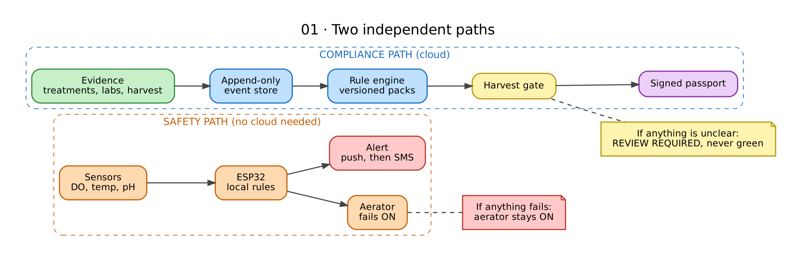

**Diagram 01.** The two paths share a platform but not a failure mode. On the left, a sensor reading reaches the aerator through local rules on the ESP32, and an alert goes out by push and then SMS. If anything fails, the aerator stays on. On the right, evidence flows into the event store, the rule engine and the harvest gate, and the result is a signed passport. If anything is unclear, the answer is REVIEW REQUIRED, never green.

---

## 4. Architecture

A modular monolith (one deployable backend with clear internal modules) plus background workers. No Kafka, Kubernetes or microservices until real load demands them.

### 4.1 System context


**Diagram 02.** Everything that talks to AquaSentinel. Green ovals are the people on the farm (owner, technician, worker). Purple ovals are outside parties: the exporter who reads lot evidence, the admin who curates rule packs, and the lab that sends signed reports. Orange is the pond hardware, which exchanges readings and commands with the platform. Grey boxes are supporting services: OCR (advisory only), weather, push and SMS delivery, an external timestamp authority and a key management service (KMS).

### 4.2 Containers and modules

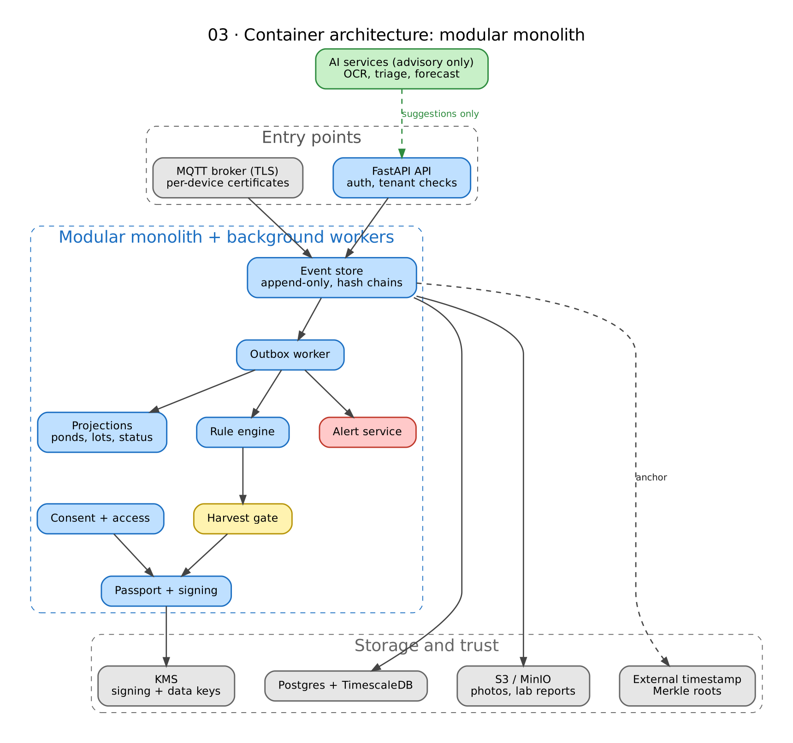

**Diagram 03.** Inside the platform. Devices come in through the MQTT broker and apps come in through the API; both write to the **append-only event store**. An outbox worker then fans events out to projections, the rule engine and the alert service. The rule engine feeds the harvest gate, which feeds the passport and signing module, with consent and access control deciding who may see the result. AI services only send suggestions into the API. Postgres with TimescaleDB holds events and projections, object storage holds photos and lab reports, KMS holds keys, and a periodic Merkle root goes to an external timestamp.

### 4.3 Pond node hardware

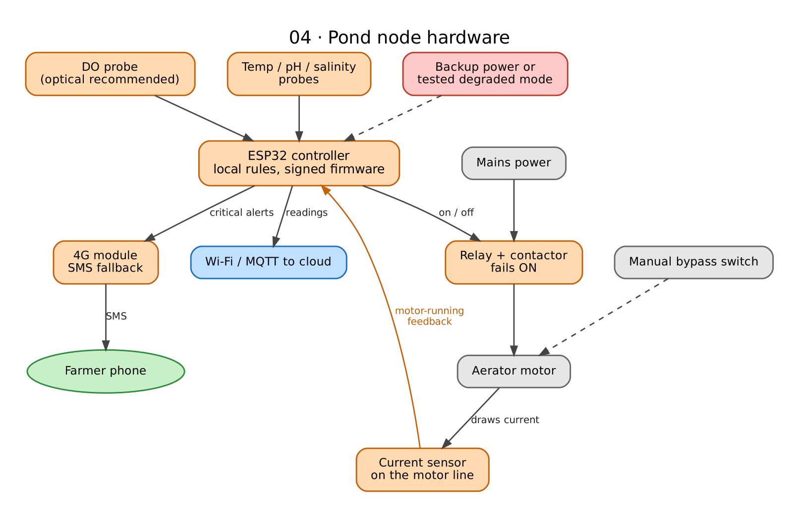

**Diagram 04.** What sits at the pond. Probes feed the ESP32, which drives the relay and contactor. A current sensor on the motor line tells the ESP32 whether the aerator really started. A manual bypass switch lets a person run the aerator with no electronics at all. Mains power needs a backup strategy or a tested degraded mode, because a relay that fails ON cannot keep a motor running through an outage. A 4G module sends critical alerts by SMS when there is no internet.

**Stack:** FastAPI, PostgreSQL with TimescaleDB, S3-compatible object storage, MQTT over TLS, Flutter for the farmer app, Next.js for the exporter and admin portals. No blockchain: per-stream hash chains with periodic Merkle anchoring give tamper evidence without one.

---

## 5. Edge safety: protecting the pond

Dissolved oxygen (DO) drops after sunset and is lowest before dawn. The ESP32 controls aeration **locally**, in two tiers:

- a **soft control band with hysteresis** (for example on below 4 mg/L, off above 5) to avoid relay chatter, and
- a **hard floor of 3 mg/L** that forces the aerator on regardless of any cloud command.

Both levels are configurable per farm and species. The published evidence on aeration setpoints is thin (one 2024 trial found no production difference between setpoints of 2.5, 3.5 and 4.5 mg/L, but higher setpoints cost more electricity), so both levels must be validated on real ponds.


**Diagram 05.** The loop that runs on the ESP32 on every reading. A reading that is invalid or stale defaults to aerator ON and alerts the farmer. A reading below the 3 mg/L hard floor forces the aerator ON and ignores the cloud. Otherwise the soft band decides: on below the ON level, off above the OFF level, and no change in between (hysteresis, to avoid relay chatter). Every action is then checked against the current sensor, and a motor that is not drawing current raises an aerator-fault alert.

**Hardware requirements, not firmware features:**

- A relay that fails ON still cannot keep an aerator running through a mains outage, so the design needs a **backup power strategy** or a stated and tested degraded mode.
- A relay command is not proof the aerator started. The **current sensor** gives feedback.
- A **failure-mode table** must cover invalid or stale readings, a disconnected sensor, a welded relay, motor failure, controller reboot and power loss.
- **Sensor self-check** flags fouled, stuck or drifting probes. **Calibration reminders** follow a per-probe schedule. An optical DO probe is recommended for the pilot, because galvanic probes drift and foul quickly and need frequent calibration, while optical ones hold calibration better but still need regular checks.
- **Alerts** (low DO, power cut, aerator fault, missing heartbeat) go by push, escalate, and also go by **SMS over a 4G module** when there is no internet. A reminder or SMS tells the farmer to act; it never replaces the local control loop.
- Firmware updates are **signed**, with rollback. Configuration changes are signed, with safe bounds.

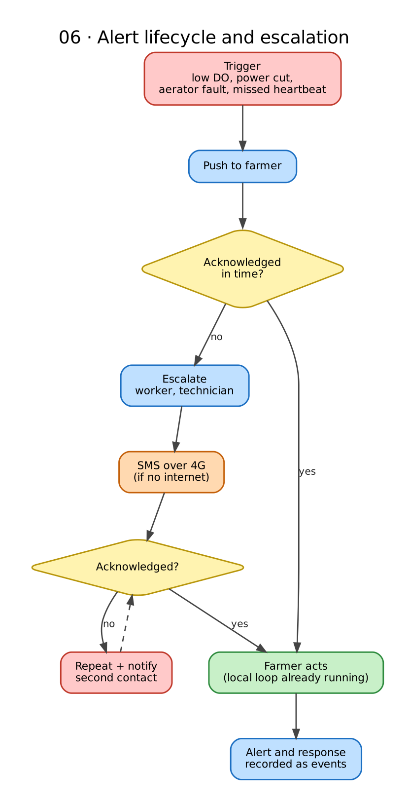

**Diagram 06.** An alert is not finished when it is sent. It goes to the farmer by push, and if nobody acknowledges it in time it escalates to the worker and the technician and goes out by SMS over 4G. If it is still unacknowledged it repeats and notifies a second contact. The alert and every response are recorded as events. The local control loop keeps running throughout.

> Mains wiring for the contactor and aerators must be done by a licensed electrician.

---

## 6. Compliance: protecting the harvest

### 6.1 From treatment to signed passport


**Diagram 07.** The farmer photographs the product label and enters the dose. OCR suggests the product, but the farmer must confirm it, because AI never decides. The rule pack then checks the product: a banned product is BLOCKED with an alert, an unknown one goes to REVIEW REQUIRED for a technician or admin, and an allowed one starts a withdrawal clock. At harvest request the gate runs again. If it fails, the lot is held with the exact reason shown, the issue is fixed and the farmer re-requests. If it passes, the passport is signed with a QR code and the exporter can view the consented lot.


Two deterministic checks guard the path. The rule-pack check runs when a treatment is logged. The harvest gate runs again at harvest and re-reads the whole log.

### 6.2 The harvest gate

The gate is a pure function of a frozen input set. **It never returns CLEARED by default.**

| Condition | Result |
|---|---|
| A mandatory rule fails (banned drug, open withdrawal clock, residue above limit) | `BLOCKED` |
| Required evidence is missing, ambiguous, inconclusive, invalid or unverified | `REVIEW REQUIRED` |
| A trust input is compromised (revoked key, failed signature) | `REVIEW REQUIRED` |
| An unexpected error occurs during evaluation | `REVIEW REQUIRED` |
| Every mandatory rule passes on verified evidence | `CLEARED` |


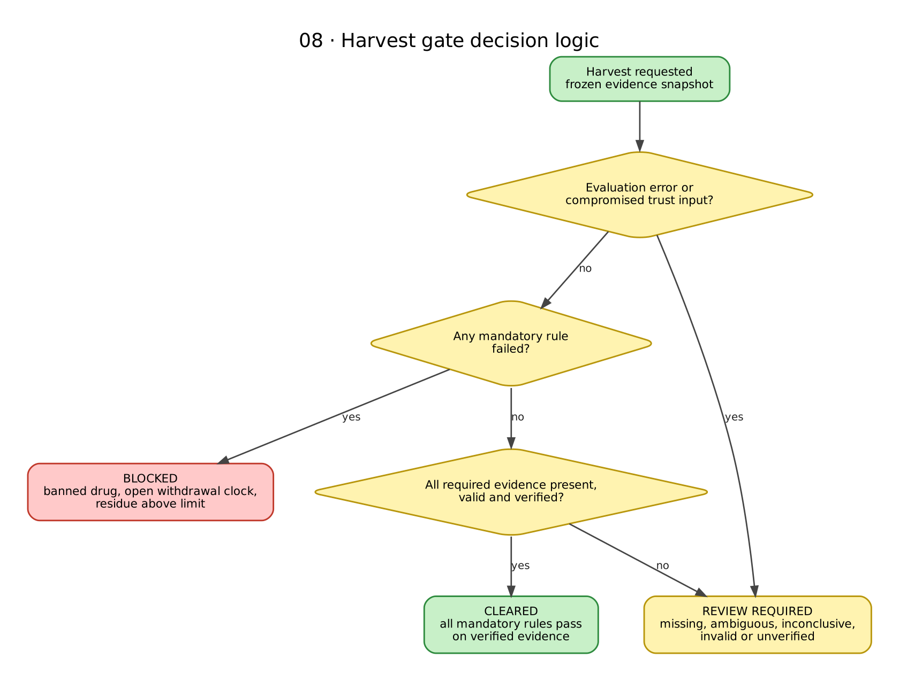

**Diagram 08.** The order of the checks matters. An evaluation error or a compromised trust input (a revoked key, a failed signature) goes straight to REVIEW REQUIRED. Otherwise a failed mandatory rule gives BLOCKED. Otherwise, if any required evidence is missing, invalid or unverified, the result is REVIEW REQUIRED. Only when every mandatory rule passes on complete, verified evidence does the gate return CLEARED.


**Diagram 09.** The states a harvest can be in. A request lands in CLEARED, REVIEW REQUIRED or BLOCKED. Review can move to CLEARED once evidence is corrected and re-evaluated, or to BLOCKED when a violation is confirmed. BLOCKED can only move back to REVIEW REQUIRED through a new correction event. A CLEARED certificate can later become Revoked (recall or a new bad result) or Superseded (a new evidence snapshot).

**Correction is not override.** Authorized people may correct evidence, resolve a product identity and trigger a fresh evaluation, and the gate then decides again. No override turns a failed mandatory rule into CLEARED. A legally permitted exception exists only as an explicit rule in the rule pack, with its authority cited. Corrections need dual approval.

### 6.3 Rule packs

A rule pack holds the banned list, maximum residue limits (MRLs) per market and withdrawal clocks. Each pack is versioned, signed and effective-dated. Each rule needs a named authoritative source and owner, the market, species, formulation and treatment context it applies to, and the legal trigger date (treatment, harvest or export).


**Diagram 10.** Admins curate a pack from authoritative sources. The rule engine is a pure function of the pack and a frozen evidence snapshot, so the same inputs always give the same result. Each result is stored with the pack id, ruleset version, engine version, evaluation time and reason codes, which lets any past decision be replayed. Publishing a new pack re-evaluates open lots.

Every gate result stores the pack id, ruleset version, engine version, evidence snapshot, evaluation time and reason codes, so any past decision can be replayed. Publishing a new pack re-evaluates open lots.

Sources for the first pack: the Coastal Aquaculture Authority's banned-substance and permissible-residual-level lists (nil for chloramphenicol and nitrofurans; 0.1 ppm for tetracycline and oxytetracycline), the Commerce Ministry's May 2025 amendment, the March 2025 health ministry notification, FSSAI notifications, and each destination market's limits and import alerts. Press reports of these lists disagree on counts, so every entry must be checked against the primary document.

The **withdrawal clock** needs the full treatment record: product identity and formulation, dose and units, species, route, administration time, and the label or regulatory basis. If any input is missing or uncertain, the gate fails closed to `REVIEW REQUIRED`.

### 6.4 Certificate lifecycle

A certificate is tied to one lot, one evidence snapshot and one rule-pack version. Five things stay separate: current eligibility, the decision at issuance, certificate validity (valid, superseded or revoked), recall status, and physical shipment status. New or corrected evidence, a rule-pack change, a revoked key or a recall each trigger re-evaluation. The QR page shows **live** status; an offline cached status is shown as **stale**.


**Diagram 11.** A certificate is issued for one lot, one evidence snapshot and one rule-pack version. It stays Valid until something changes: new evidence makes it Superseded, a recall or failed re-check makes it Revoked. The QR page reads the live state, or marks a cached copy STALE when it is offline.

---

## 7. Lots, evidence and trust

### 7.1 Lot lineage

Treatments attach to a **crop cycle**, never directly to a lot, and every lot inherits from its source. Every treatment also carries an explicit **scope** (whole pond, a section, or a defined population).


**Diagram 12.** Treatments and pathogen tests attach to the crop cycle, so every lot harvested from it inherits them. A partial harvest can produce several lots. A lot from another pond can merge with them, and the merged lot's restrictions are computed by rule, not by a blanket strictest-value shortcut. Residue samples and tests follow the lot they were taken from.

If one treated pond is harvested into three lots, all three inherit its treatment history. If two lots merge, the result carries the evidence of both, and its restrictions are computed by the applicable rule, never by a blanket "strictest value" shortcut. A passing residue result is never carried onto a merged lot unless the sampling and compliance rules permit that inference.

### 7.2 What each claim is backed by

| Claim | Asserted by | Backed by | Limit |
|---|---|---|---|
| Treatment was applied | Farmer | Label photo, invoice and inventory reconciliation, technician check | Cannot prove every application was logged |
| Water conditions | Device | Calibrated probe, sensor-quality checks | Only as good as the calibration |
| Pathogen status | Lab or technician | Signed PCR report | Says nothing about drug residue |
| Residue below limit | Lab | Signed report: sample ID, collection time, lot link, method, analyte, units | Valid only if the sample came from that lot |
| Harvest eligible | Rule engine | Versioned rules and an evidence snapshot | Correct only if the rule pack is correct |
| Certificate | AquaSentinel | Signature over lot, evidence snapshot and rule version | AquaSentinel evidence, not government clearance |

**Lab evidence is not automatically enough.** The rule pack defines accepted laboratories, suitable methods and analytes, reporting limits, sample-custody checks, and how invalid or inconclusive tests are handled. Residue evidence carries one of six statuses: `NOT_DETECTED`, `DETECTED_WITHIN_LIMIT`, `DETECTED_ABOVE_LIMIT`, `INCONCLUSIVE`, `INVALID`, `INCOMPLETE`. Only the first two can support clearance, and only where the rules permit. `NOT_DETECTED` means not detected by that method at that reporting limit, never proven absent.

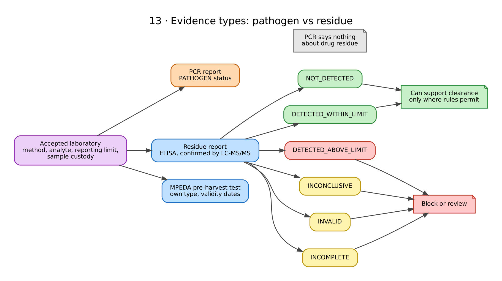

**Diagram 13.** Two different kinds of lab evidence. A PCR report describes pathogen status and says nothing about drug residue. A residue report (ELISA screening, with positives confirmed by LC-MS/MS) ends in one of six statuses. Only NOT_DETECTED and DETECTED_WITHIN_LIMIT can support clearance, and only where the rules permit. The other four send the lot to block or review. MPEDA's pre-harvest test is its own evidence type with validity dates.

MPEDA's pre-harvest test is modelled as its own evidence type with validity dates. It covers a fixed list of compounds and is mandatory only for EU-bound shrimp.

### 7.3 Invoice and inventory reconciliation

Capture each purchase (invoice photo, product identity, quantity, batch), keep a stock ledger, compare expected usage with logged treatments, and send unexplained gaps to a technician's review queue. This shows that a product was bought and flags stock that vanished without a logged treatment. It cannot prove a dose was applied or that every application was recorded.

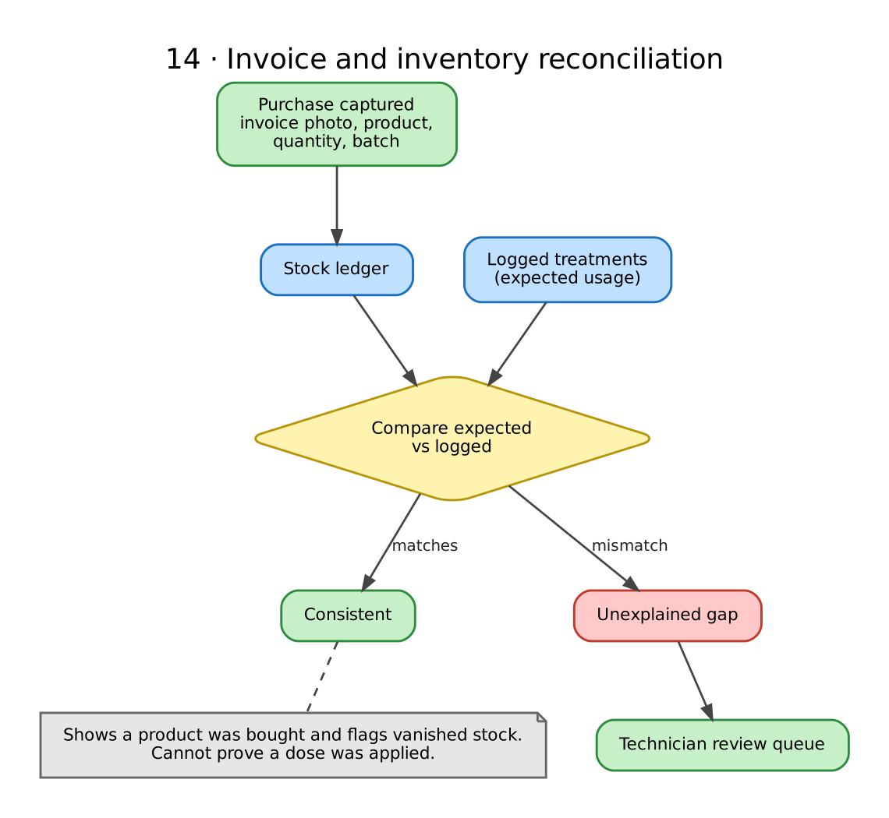

**Diagram 14.** Each purchase becomes a stock entry, and logged treatments give the expected usage. When the two match, nothing happens. When they do not, the gap goes to a technician's review queue. The check shows a product was bought and flags stock that vanished, but it cannot prove a dose was applied.

---

## 8. The event log

Every fact the system relies on is an **immutable event**. Tables, dashboards and certificates are projections that can be rebuilt by replaying events. A correction is a new event that points at the one it corrects.

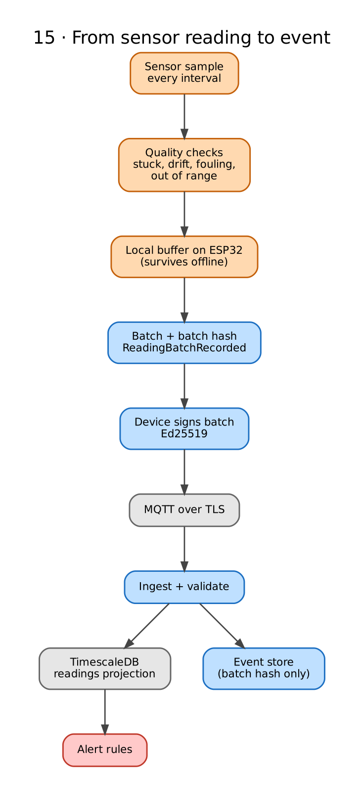

**Diagram 15.** How raw sensor readings become events. The ESP32 checks quality (stuck, drifting, fouled or out-of-range probes), buffers locally so nothing is lost offline, then batches readings with a batch hash and signs the batch. The cloud validates it and stores only the batch hash in the event store, while the readings themselves go to TimescaleDB, where alert rules run.

The full design is in the Event Schema doc. In short:

- **One envelope, 27 fields**, with typed payloads. The author fills some fields; the server assigns `stream_seq`, `received_at`, `previous_hash` and `event_hash`.
- **Three clocks:** `occurred_at` (claimed), `recorded_at` (device) and `received_at` (server). Only `received_at` is trusted. An unverified timestamp can only make a withdrawal clock longer, never shorter.
- **36 event types** across four streams (`farm`, `cycle`, `lot`, `rulepack`). Raw sensor rows are batched into `ReadingBatchRecorded` events with a batch hash.
- **Per-stream hash chains**, signed with Ed25519 where required (devices, labs, the passport service, rule-pack approvers), with periodic Merkle roots and an external timestamp.


**Diagram 16.** The path every event takes. A duplicate with the same hash returns the original result. A new event is validated, then written in one transaction that assigns its sequence number, server time and hashes and adds an outbox row. The author gets an acknowledgement, flagged if there was clock drift, a sequence gap or backdating. A worker then updates projections, runs the rule engine and raises alerts.

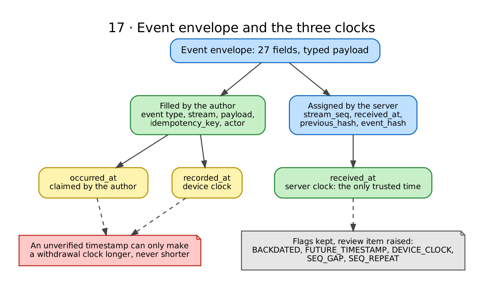

**Diagram 17.** The envelope has 27 fields: some filled by the author, some assigned by the server. Three clocks are kept, and only the server's `received_at` is trusted. Flags such as BACKDATED, FUTURE_TIMESTAMP, DEVICE_CLOCK, SEQ_GAP and SEQ_REPEAT are kept and raise a review item.

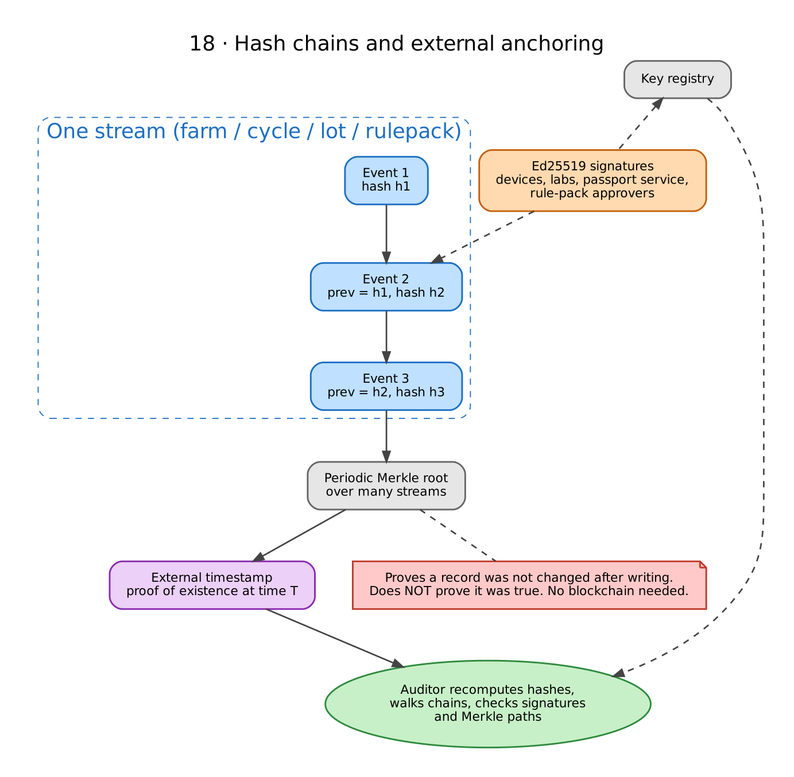

**Diagram 18.** Each stream links every event to the previous one by hash, so changing an old event breaks every later hash. A periodic Merkle root over many streams is sent to an external timestamp. Signatures from devices, labs, the passport service and rule-pack approvers are checked against a key registry. An outside auditor can recompute all of it. This proves a record was not changed after it was written; it does not prove it was true.

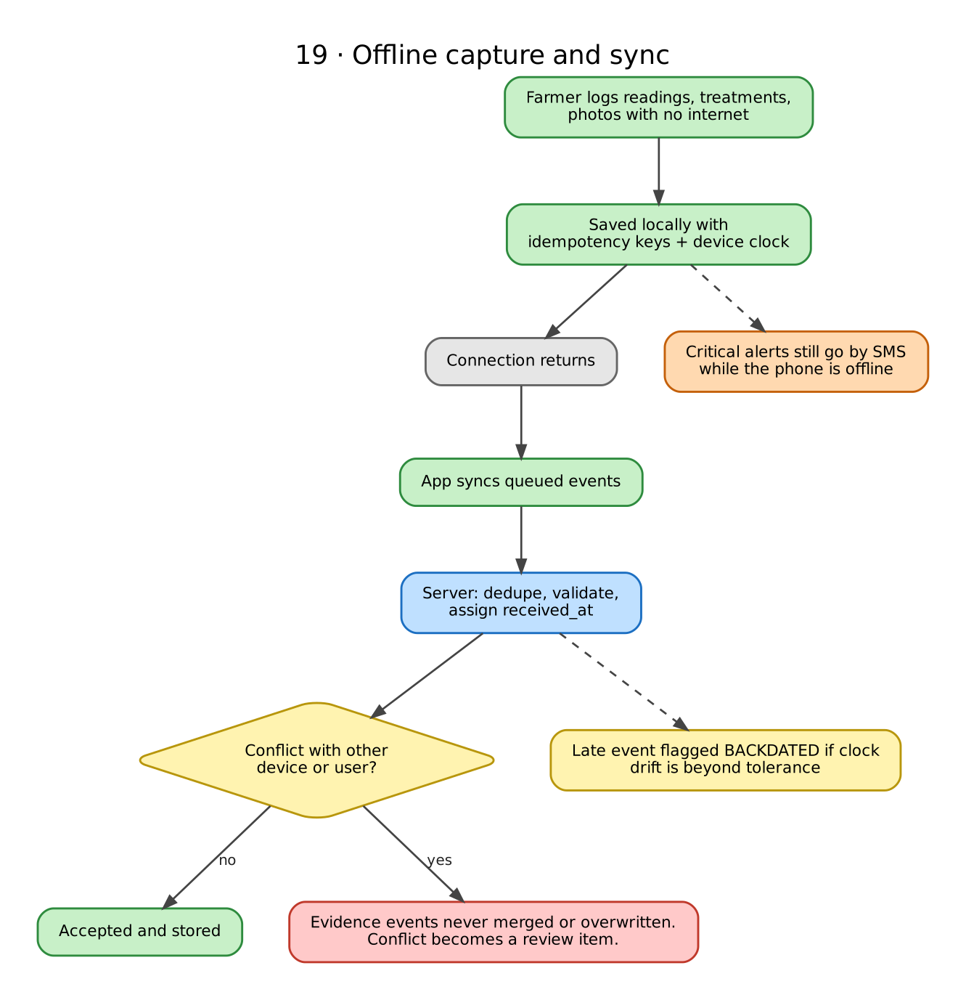

**Diagram 19.** Offline capture. The app saves events locally with idempotency keys and syncs when the connection returns. The server deduplicates, validates and assigns receive time. Evidence events are never merged or overwritten, so a conflict becomes a review item. Late events may be flagged as backdated, and critical alerts still go by SMS.

Rejected events are not stored in the chain (the attempt is logged operationally). Flagged events are kept and raise a review item. Evidence events (treatments, tests, harvests, lot changes) are never merged or overwritten; conflicts from offline devices become review items.

---

## 9. Who uses it

| Role | What they do |
|---|---|
| **Farmer** (owns the data) | Sets up ponds and crop cycles, logs readings and treatments (offline), acts on alerts, requests harvest, issues and revokes exporter consent |
| **Technician** (verifier) | Verifies entries against invoices, collects samples, logs PCR and residue results, resolves reviews, calibrates probes |
| **Exporter or processor** (consented) | Receives a revocable grant, views lot evidence and status, scans the QR page, raises queries or recall requests |
| **Admin** (governance) | Curates and signs rule packs, approves corrections, runs recalls, registers keys |

Tenant = farm. Users are modelled separately from farms through farm memberships, so one person can belong to more than one farm or hold a technician or lab relationship. Tenant isolation applies to API endpoints, background jobs, exports and object storage, not only the dashboard.

Exporters see a lot only through a consent grant scoped to that lot. Revoking consent stops later access through AquaSentinel; it cannot delete copies already downloaded, and the consent screen says so.

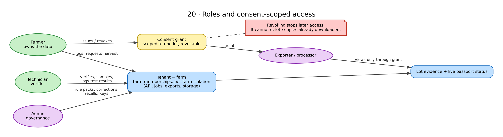

**Diagram 20.** The farm is the tenant. Farmers log data and request harvests, technicians verify and log test results, and admins manage rule packs, corrections, recalls and keys. An exporter can see a lot only through a consent grant that the farmer issues, scoped to that lot and revocable.

---

## 10. Features and roadmap

**Tier 1: the MVP (19 features)**

- Farm, pond and crop-cycle setup; lot lineage (split and merge); roles and farm-scoped access
- Sensor readings (real or simulated); two-tier aerator safety rules; sensor self-check and calibration reminders; SMS fallback for critical alerts; critical alerts with escalation and dead-man heartbeat
- Offline capture and sync
- Treatment logging with label-photo OCR and mandatory human confirmation; invoice and inventory reconciliation; product normalisation and withdrawal clocks
- Pathogen (PCR) test logging; residue test logging (including MPEDA pre-harvest certificates)
- Harvest gate; event history; crop passport with signed QR; consent-based exporter portal
- Daily pond briefing and task reminders (a read-only view of overnight minimum DO, equipment faults, withdrawal deadlines, open reviews and sampling due)

**Tier 2: added selectively.** DO forecast (advisory, unproven until validated on real sensors); rule-based risk indicators (can use rain and air temperature); toxic ammonia estimate from pH, temperature and salinity (method to verify); photo observation log; experimental photo triage; manual sampling and growth; seed (PL) source records; own-pond map; evidence reports for buyers, banks and insurers; treatment-cost tracking; online voice assistant (English plus one local language).

**Tier 3: deferred, with a trigger.**

| Feature | Why it waits |
|---|---|
| Expense tracker, price forecast, harvest planner | Generic and crowded; models not yet reliable |
| Regional outbreak map | Needs enough participating farms and privacy controls. Thresholds (such as 5+ farms per area) are proposals, to be set from real disclosure risk |
| Hydrophone feeding | Extra hardware; acoustic feeding already exists in the market; no residue benefit |
| Photo-based shrimp counting | No good public dataset; turbid water |
| Offline LLM or VLM | A 1B model cannot reliably enforce dosing guardrails; use retrieval-only offline answers |
| Government schemes knowledge base | Only with sourced, dated content |

**Competitors.** AquaExchange (IoT automation, acoustic feeding, microscopy-based health AI, finance, market linkage) and Aquaconnect (FarmMOJO advisory and records, marketplace, credit) are real and well established. Both mention traceability. I found no withdrawal-period enforcement or harvest gating on their public pages, though that was not an exhaustive check.

---

## 11. Security and privacy

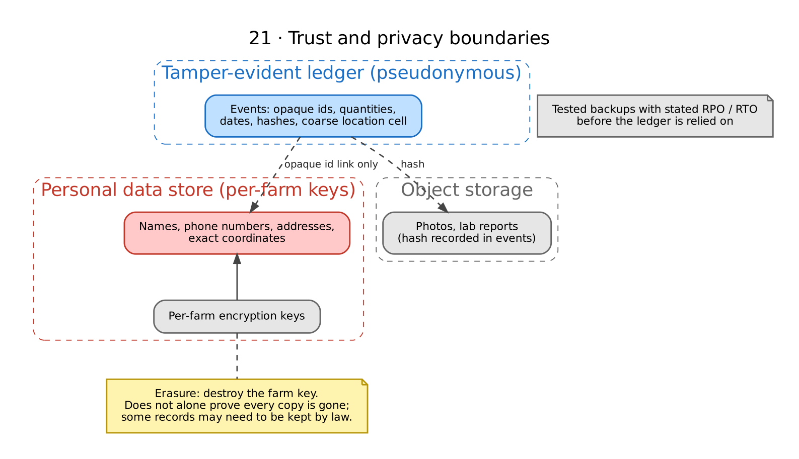

**Diagram 21.** What lives where. The tamper-evident ledger holds only opaque ids, quantities, dates, hashes and a coarse location cell. Names, phone numbers, addresses and exact coordinates sit in a separate store encrypted with per-farm keys, linked only by opaque ids. Photos and lab reports sit in object storage with their hashes recorded in events. Destroying a farm's key makes its encrypted copies unreadable, though that alone does not prove every copy is gone.

- **Integrity, not truth.** Hash chains show records were not changed after being written. Truthfulness comes from the evidence flows in section 7.
- **Signing.** Devices sign telemetry, labs sign reports, and the passport service signs certificates with a KMS key. A key registry lets anyone verify a certificate without trusting the app. A compromised key invalidates only signatures made after the compromise time, and every certificate resting on them goes back through the gate. Manual key rotation from the start; automation later.
- **Auditor verification.** An outside auditor can recompute hashes, walk each chain, check signatures against the key registry, and verify Merkle paths and timestamp proofs.
- **Personal data stays outside the chain.** Events hold opaque ids, quantities, dates and hashes. Names, phone numbers, addresses and exact coordinates live in separate tables encrypted with per-farm keys. Location in an event is a coarse cell, never coordinates.
- **Erasure.** Destroying a per-farm key makes encrypted copies unreadable, but that alone does not prove every copy is gone, and the law may require some records to be kept. India's DPDP Rules were notified in November 2025, and the retention and erasure provisions are reported to take effect on 13 May 2027. The chain is pseudonymous, not anonymous. A data inventory, backup-expiry rule and legal review are needed before claiming DPDP compliance.
- **Access.** Phone-based login, role-based access, per-farm isolation, TLS everywhere, per-device certificates for MQTT.
- **Recovery.** Tested backups and restores with a stated recovery point and recovery time objective, before the ledger is relied on as compliance evidence.

---

## 12. Pilot plan

Treat **20 to 30 ponds in one cluster**, with one processor, exporter or hatchery partner, as a **feasibility pilot**. It can prove the workflow and the data capture. It cannot prove that the AI is accurate or that rejections will fall.

Measure:

1. Share of harvests with a complete ledger
2. Residue-risk events caught before harvest
3. Alert lead time, measured separately for pathogen events (against PCR) and residue findings (against a residue test)
4. Alert precision and sync reliability

Before starting: measure the current recording and pre-harvest verification process as a baseline; set pass and fail thresholds; use signed lab results and technician checks as the reference, never the system's own predictions. Twenty to thirty ponds will see too few outbreaks to validate a model, so evaluate models on a separate, larger dataset.

**Build priorities**

| Priority | When | Work |
|---|---|---|
| 0 | Before relying on it for real decisions | Agree with one exporter what evidence they will accept; separate pathogen and residue testing; lab acceptance criteria and result statuses; the harvest-gate decision contract; full treatment event with scope; lot lineage and merge rules; rule-pack sources and replay; aerator failure-mode table |
| 1 | Before the first real compliance pilot | Signed lab evidence and sample custody; invoice reconciliation; the event schema; signing and key-compromise process; roles, isolation and scoped consent; QR signing and certificate lifecycle; daily briefing; tested backups |
| 2 | Once the evidence workflow works | Pilot baselines; evaluate the DO forecast and disease triage against real ground truth; growth tracking, evidence reports, expenses, assistant |

**Hackathon demo.** A sensor simulator, an outbreak button, a label scan that blocks a harvest ("withdrawal ends in 9 days"), a QR certificate and an exporter lot view. Make its limits visible: label simulated data as synthetic, show the OCR result, the human confirmation and the rule-pack version, show the exact reason for each block, keep pathogen and residue results separate, and show each certificate's evidence and whether it is independently verified.

---

## 13. Planned repository layout

```
aquasentinel/
├── firmware/            # ESP32 project: sensors, two-tier DO control, relay feedback, SMS
├── app/                 # Flutter farmer and technician app (offline-first)
├── web/
│   ├── exporter/        # Next.js exporter portal and public QR status page
│   └── admin/           # Next.js admin console: rule packs, corrections, recall
├── backend/
│   ├── api/             # FastAPI service and ingestion
│   ├── events/          # event store, hash chains, projections, replay
│   ├── rules/           # rule engine and harvest gate
│   ├── passport/        # certificates, signing, key registry
│   ├── workers/         # outbox, alerts, reports
│   └── ai/              # OCR, triage, forecast (advisory only)
├── schemas/events/      # JSON Schema per event type and version
├── rulepacks/           # versioned, signed rule packs with source references
├── infra/               # docker-compose, MQTT config, CI
└── docs/                # design docs and diagrams
```

---

## Open items

- Read the **primary** CDSCO and MPEDA letters behind the 43% and 74% figures (only press reports were seen).
- Check competitor feature claims beyond their public pages.
- Collect **destination-market residue limits** for the rule pack.
- Validate the DO setpoints and calibration intervals on the real probe and real ponds.
- Settle the event-schema choices: telemetry window, backdating tolerance (48 hours is a placeholder), whether farmer and technician events are signed at the pilot, anchoring schedule, and JSON Schema versus Protobuf.
- Get **legal review** of the erasure approach and the certificate wording before any claim of compliance.
- Agree with a real exporter or processor what evidence they will accept.

---

## References

Checked on 21 Oct 2026.

**Regulation and testing**
- [The South First: Andhra farms drove 74% of antibiotic shrimp rejections](https://thesouthfirst.com/health/andhra-farms-drove-74-of-indias-antibiotic-shrimp-rejections-centre-seeks-answers-from-states/)
- [Medical Dialogues: CDSCO seeks state action on banned antibiotic residues](https://medicaldialogues.in/news/industry/pharma/banned-antibiotic-residues-trigger-shrimp-export-rejections-cdsco-seeks-state-action-172076)
- [MPEDA: Pre-Harvest Testing of aquaculture products](https://mpeda.gov.in/?p=1094)
- [Coastal Aquaculture Authority: permissible residual levels](https://www.caa.gov.in/uploaded/doc/PermissibleResidual.pdf)
- [FDA LIB 4682: LC-MS/MS for nitrofuran metabolites and chloramphenicol](https://fda.gov/media/169779/download)
- [S&P Global: compliance risks for India's shrimp sector (EU and Japan inspection rates)](https://www.spglobal.com/energy/en/news-research/latest-news/agriculture/020326-compliance-risks-rising-for-indias-shrimp-sector-amid-new-ftas-mpeda-chairman)
- [FSMA 204 compliance date of 20 July 2028](https://reliamag.com/guides/fsma-rule-204-compliance/)
- [Mondaq: DPDP retention and deletion](https://www.mondaq.com/data-retention-and-deletion-under-the-dpdp-act-how-long-can-businesses-retain-personal-data-in-india/1844062)

**Science and sensors**
- [ICAR KRISHI: economic loss due to diseases in Indian shrimp farming](https://krishi.icar.gov.in/jspui/handle/123456789/43787)
- [HORIBA: galvanic vs optical DO sensors](https://www.horiba.com/int/water-quality/support/technical-tips/electrodes/galvanic-vs-optical-dissolved-oxygen-sensors/)
- [Global Seafood Alliance: automated DO sensing and aerator activation](https://www.globalseafood.org/advocate/automated-dissolved-oxygen-sensing-and-aerator-activation-in-aquaculture/)
- [Auburn: DO setpoints for aeration in vannamei ponds](https://etd.auburn.edu/handle/10415/9214)
- [Mendeley: ShrimpDiseaseImageBD dataset](https://data.mendeley.com/datasets/jhrtdj9txm/3)

**Market**
- [Inc42: AquaExchange Series B](https://inc42.com/buzz/aquaexchange-raises-8-mn-series-b-eyes-%E2%82%B9275-cr-revenue-in-fy26/)
- [Fishwise: Aquaconnect](https://fishwise.org/aquascape/aquaconnect/)

---

## License

To be decided. MIT is suggested for the code. Datasets and third-party models keep their own licences; check each one before shipping.
